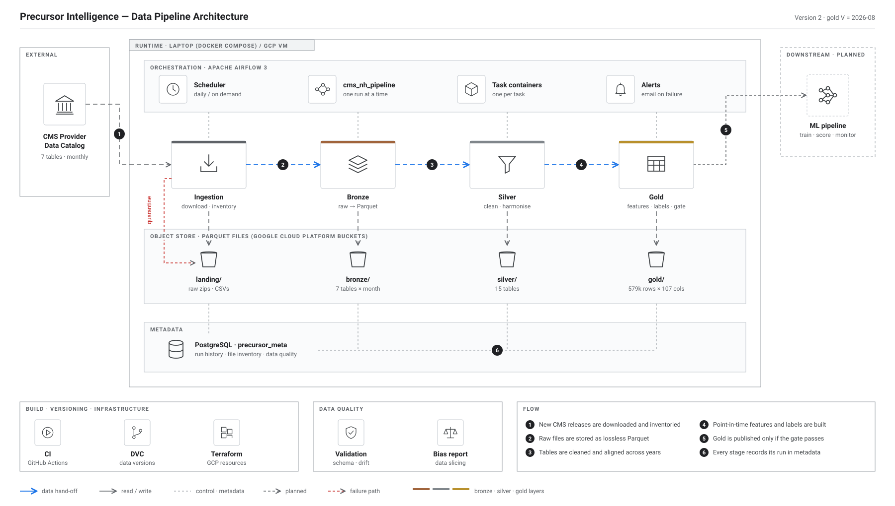
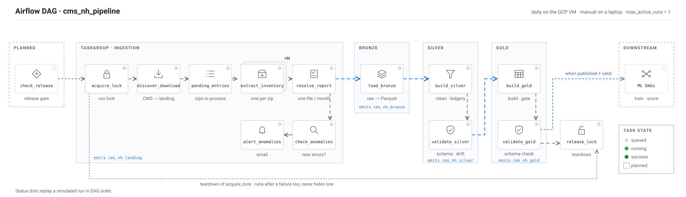
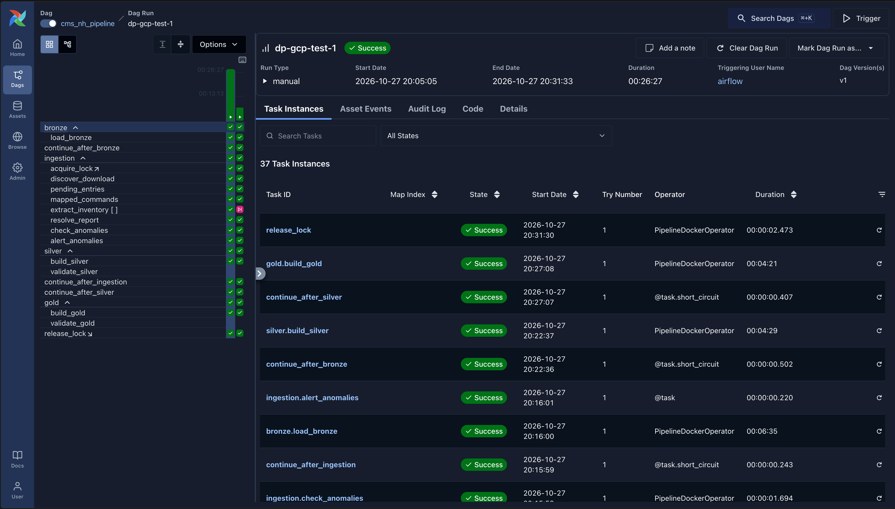

# Precursor Intelligence

An end-to-end MLOps application - Nursing Homes Risk Assessment for the Insurance Industry.

Every month, Precursor Intelligence gives each U.S. nursing home (CMS-certified skilled nursing facility) a
calibrated probability of a **serious health citation (scope/severity G–L) in the next 12 months**, for
long-term-care liability insurers. An Airflow 3 pipeline turns the monthly CMS open-data releases into a
point-in-time training table; LightGBM and four Pydantic AI agents turn that table into calibrated, explained
scores.

> **Status (branch `dev`, October 2026):** the **data pipeline is built and runs end to end**, locally and against
> the GCS bucket: ingestion → bronze → silver → gold, with schema and drift validation, data bias slicing,
> alerts, DVC and CI. The ML phase (training, scoring, serving, monitoring) is next.

---

## Contents

1. [What is built](#1-what-is-built)
2. [Architecture](#2-architecture)
3. [The data](#3-the-data)
4. [The pipeline, layer by layer](#4-the-pipeline-layer-by-layer)
5. [The Airflow DAG](#5-the-airflow-dag)
6. [Data validation](#6-data-validation)
7. [Data bias detection and mitigation](#7-data-bias-detection-and-mitigation)
8. [Storage, metadata and environments](#8-storage-metadata-and-environments)
9. [Getting started](#9-getting-started)
10. [Tests and CI](#10-tests-and-ci)
11. [Data versioning with DVC](#11-data-versioning-with-dvc)
12. [Repository layout](#12-repository-layout)
13. [Documentation map](#13-documentation-map)
14. [Known limitations and next steps](#14-known-limitations-and-next-steps)
15. [Branching](#15-branching)
16. [Rules before making a PR to `dev`](#16-rules-before-making-a-pr-to-dev)

---

## 1. What is built

| Area | What it does | Status |
|---|---|---|
| Ingestion | Discovers and downloads the CMS archive and current release, extracts the 7 in-scope tables, inventories every file and picks one per table and month | Built |
| Bronze | Every selected file as lossless, all-text Parquet per table and month, with lineage and content hashes | Built |
| Silver | Harmonised column names and types across six years of CMS renames; event ledgers; facility universe; calibration of label buffers | Built |
| Gold | Point-in-time spine, 5 feature families, labels, splits and the training table; a quality gate before promotion | Built |
| Validation | Pandera schema contracts and month-over-month drift checks on silver and gold, inside the DAG | Built |
| Bias slicing | Representation, label-rate disparity, home-level significance tests, inspector (state) effects, missingness, censoring and drift per slice; train-only sample weights | Built (CLI) |
| Orchestration | One Airflow 3 DAG, one Docker container per task, run lock with teardown, exit-code retries, email alerts | Built |
| Cloud | Runs against `gs://precursor-intel-mlops-data`, one folder per layer; Terraform for GCP | Built |
| Reproducibility | DVC test pipeline, deterministic outputs, manifests with sha256s, CI on Python 3.11 and 3.12 | Built |
| Release gate | `check_release`: run only when CMS publishes something new | Planned |
| ML phase | Training, calibration, batch scoring, monitoring, agents, API and dashboard | Next |

**Latest real run (gold V = 2026-08):** 578,975 home-months × 107 columns, 15,274 homes, 39 monthly partitions
(t = 2023-01 → 2026-08). A full backfill through Airflow into the GCS bucket ran 37/37 tasks green in 26.5 min and
gave gold byte-identical to the local-disk run of the same zips (PR #30).

---

## 2. Architecture



*The data pipeline. Numbered steps: 1 new CMS releases are downloaded and inventoried · 2 raw files are stored as
lossless Parquet · 3 tables are cleaned and aligned across years · 4 point-in-time features and labels are built ·
5 gold is published only if the gate passes · 6 every stage records its run in metadata. Dashed parts are planned;
the moving dashes show the direction of the data flow.*

- **Files stay files.** Every layer is Parquet on one object store: local disk in development, Google Cloud Storage
  in test and production. All I/O goes through the `ObjectStore` / `TableSink` ports, so the same code runs on
  both. No database for intermediate layers.
- **DAGs are thin.** Every task runs exactly one CLI command (`precursor-ingest …` or `precursor-pipeline …`) in
  the `precursor-pipeline` image. The same commands run by hand, in tests and in Airflow.
- **Behaviour lives in `configs/`**, logic in `src/precursorintelligence/`, wiring in `dags/`.
- **Laptop = GCP.** The compose file, images and DAG are identical; only `docker/airflow-local/.env` differs.

The full write-up, with every component, path and table: [`docs/DATA_PIPELINE_SPEC.md`](docs/DATA_PIPELINE_SPEC.md)
and [`docs/AIRFLOW_PIPELINE.md`](docs/AIRFLOW_PIPELINE.md).

---

## 3. The data

### 3.1 Source

CMS Provider Data Catalog, nursing homes: the archive of monthly releases plus the current release and the
metastore API. Vintages **2021-01 → 2026-08** (66 monthly archive zips, plus the current release). The month a release describes is read from the
`Processing Date` inside each file, never from the zip name. CCN (the facility id) is always 6-character text.

| CMS table | Grain | Used for |
|---|---|---|
| Provider Information | home × release | Facility universe; facility, staffing, turnover and status features |
| Health Deficiencies | one citation | Citation-history features; the G–L labels |
| Inspection Dates | one survey | When the next inspection is due |
| Penalties | one penalty | Enforcement features; penalty labels |
| MDS Quality Measures | home × measure × release | Clinical-risk features (family pending approval) |
| Medicare Claims Quality Measures | home × measure × release | Hospitalisation and ED-visit features (pending) |
| Citation Code Look-up | one F-tag | Tag → category and description |

### 3.2 Targets

| Label | Definition | Role |
|---|---|---|
| `y_g12` | Any health citation with scope/severity **G–L** on a survey in the next **12 months** | Primary model |
| `y_g6` | The same over 6 months | Between-renewal early warning |
| `y_pen12` | Any fine or payment denial in the next 12 months | Built for comparison; role open |

### 3.3 The two leakage rules

1. **Features** for month t use only what CMS had published in the release of month t (plus t−6 and t−12 for
   change features), with `event_date <= cutoff_date`.
2. **Labels** count only events strictly after `cutoff_date` and within the horizon, from **event ledgers** that
   union every release (closed homes and old inspection cycles drop out of later files). A label is final only
   after its maturity buffer: **8 months for citations, 12 for penalties**, measured on the archive.

Both rules are enforced in gold and tested in `tests/leakage`.

### 3.4 Gold training table (`gold/facility_month_dataset`, partitioned by t)

| Column group | Columns | Notes |
|---|---|---|
| Keys and date | `ccn`, `t`, `cutoff_date` | One row per home and month |
| Survey timing | 9 | Days since / until the standard survey, overdue flag, survey counts |
| Citations | 26 | Counts by severity band and category, severity points, worst severity on recent surveys |
| Enforcement | 7 | Fines and payment denials: counts, amounts, recency |
| Facility and staffing | 47 | Beds, ownership, hours per resident day, turnover, CMS footnotes, 6- and 12-month changes |
| Context | 6 | The state's G+ rate and median staffing, the home relative to its state, rating era |
| Labels, status, splits | 9 | `y_*`, `status_*` (positive / negative / immature / censored), `split_*` |

95 registered features (`configs/feature_registry.yaml`): 90 `model`, 4 `ablation_only` (star ratings, never
features), 1 `product_only` (`chain_id`). Splits for `y_g12` at V = 2026-08: train 90,419 · calib 44,959 ·
purge 163,584 · test 29,621 · score 250,392 rows; a purge gap of H months separates train from test because the
label windows overlap.

Every gold run also writes the same rows, columns and dtypes as **one file**, `gold/facility_month_dataset.parquet`
(sorted by `t`, then `ccn`), for readers that want a single file. It is rebuilt in full each run, never appended to
(revised history, matured labels and moved splits change earlier months), promoted with the other outputs, and its sha256
is in `gold/_current.json` and under `merged_file` in `dataset_manifest.json`.

---

## 4. The pipeline, layer by layer

| Layer | Command | Reads | Writes | Metadata |
|---|---|---|---|---|
| **Ingestion** | `precursor-ingest step1 …` | CMS archive, current release, metastore | `landing/cms_nh/{catalog,zips,extracted}/`, `quarantine/` | catalog, source_datasets, download_log, extracted_files, inventory, anomalies |
| **Bronze** | `precursor-pipeline bronze` | selected inventory rows, landing CSVs | `bronze/<table>/vintage=YYYY-MM/` (7 tables) | bronze_files, vintage_flags |
| **Silver** | `precursor-pipeline silver [--calibrate]` | bronze; column map, keep-lists, value maps | 15 silver tables, ledgers, universe, `gold/dim_facility_latest` | silver_partitions |
| **Gold** | `precursor-pipeline gold` | silver, ledgers; labels, splits, feature registry | `gold/` spine, features, labels, dataset (per month and as one merged file), `_current.json`, manifest | run_log |

- **Ingestion:** checksums and size checks; failed downloads go to `quarantine/`, never to landing; one file per
  table and month is selected; a Checkpoint 1 report and anomaly alerts.
- **Bronze:** refuses to start while any inventory row is pending; flags releases CMS republished without changes
  (`stale_refresh`, e.g. 2025-09).
- **Silver:** maps every raw header to one canonical name by vintage range (checked against all 427 selected
  files); unions events into ledgers; in backfill, measures posting lag to set the maturity buffers.
- **Gold:** builds in `gold/_staging/run=<id>/`, then runs a gate (structure, label logic, leakage, coverage).
  Any failed check is exit 2 and nothing is published; on a pass, gold is promoted and `gold/_current.json`
  records each file's sha256.

**Gold is rebuilt, not appended.** Every run recomputes the whole table from silver, so a new month is never just added at
the bottom: old rows change when new data arrives.
- **Labels mature.** A row that is `immature` today (its 12-month window is still open) becomes positive or negative later;
  appending would leave the old "unknown" in place for ever.
- **Splits move.** Each new V shifts the train / calibration / purge / test windows, so many old rows change their split.
- **CMS revises history.** Citations are corrected or removed, which changes older features.

Rows that did not change come out byte-identical, so a full rebuild is cheap to check (the sha256s in `gold/_current.json`).

---

## 5. The Airflow DAG

One DAG, `cms_nh_pipeline` (Airflow 3, `max_active_runs=1`): manual on a laptop, daily on the GCP VM.



*Every task of the DAG, grouped by TaskGroup. Blue arrows hand an Airflow asset to the next group; the purple
dotted line is `release_lock`, the teardown of `acquire_lock`. The status dots replay a simulated run in DAG order
(they are not live Airflow state). Dashed tasks are planned.*



*The Airflow Gantt chart of a successful `cms_nh_pipeline` run on GCP: every task's start and duration, with all
layers written to the GCS bucket.*

```
acquire_lock → discover_download → pending_entries → extract_inventory[one per zip] → resolve_report
  → check_anomalies → alert_anomalies                                    (asset cms_nh_landing)
  → load_bronze                                                          (asset cms_nh_bronze)
  → build_silver → validate_silver                                       (asset cms_nh_silver)
  → build_gold → validate_gold                                           (asset cms_nh_gold)
release_lock = teardown of acquire_lock (runs after a failure too)
```

| Mechanism | How it works |
|---|---|
| Run lock | `data_pipeline` lock in `run_lock`; one run at a time; stale after 12 h |
| Teardown | `release_lock` is an Airflow teardown of `acquire_lock`, so a failed run still shows as failed |
| Exit codes | 0 ok · 1 error (retried 2 × 5 min) · 2 bad data / validation · 3 bad config (2 and 3 fail at once) |
| Mapping | `extract_inventory` is mapped, one copy per pending zip, up to 3 in parallel |
| Assets | `cms_nh_landing` → `cms_nh_bronze` → `cms_nh_silver` → `cms_nh_gold` (only when gold publishes and validates) |
| Alerts | Email (`PI_ALERT_EMAIL_TO`): every failed run, a failed `release_lock`, new error anomalies |
| Params | `mode` (monthly / backfill), `calibrate`, `stop_after` (node by node), `entry_ids` (development) |
| Run modes | Monthly: only new or changed inputs; gold rebuilds and recomputes every label. Backfill: everything plus calibration |

### 5.1 Pipeline flow optimisation

The Gantt chart above (a full backfill of 23 zips into the GCS bucket, 37 tasks, 26.5 min) shows where the time goes:

| Task group | Time | Note |
|---|---|---|
| Download | 95 s | mapped, up to 3 zips in parallel |
| Bronze | 396 s | **the bottleneck**: one task for every table and month; peak memory about 2.3 GB |
| Silver | 270 s | one task, plus calibration in a backfill |
| Gold | 262 s | rebuilt in full each run; peak memory about 2.2 GB on the subset |

What already speeds a run up (measured in [`docs/runbooks/airflow-local.md`](docs/runbooks/airflow-local.md) §8.2, local disk):
- **Only new or changed inputs are processed.** A monthly run skips every zip and file it already has: a rerun of 23
  already-processed zips took 56 s, against 107 s for the first load of 14, and bronze and silver outputs are byte-identical.
- **Parallel per-zip extraction** (`extract_inventory` is mapped, up to 3 at once).
- **`stop_after`** runs a node at a time, and a monthly run validates only the latest silver month.

The next step would be to split bronze by table so its tasks run in parallel; it is not built yet.

Details and the metadata schema: [`docs/AIRFLOW_PIPELINE.md`](docs/AIRFLOW_PIPELINE.md). Running it:
[`docs/runbooks/airflow-local.md`](docs/runbooks/airflow-local.md).

---

## 6. Data validation

`precursor-pipeline validate --layer silver|gold` checks a layer month by month and changes nothing.

- **Schema (Pandera, `configs/contracts/<table>.yaml`):** missing or unexpected columns, types, nulls, ranges,
  allowed values, the CCN pattern, unique keys, and label consistency (`y` null exactly when immature or
  censored, `split = score` exactly when immature).
- **Drift vs the previous month (`configs/validation.yaml`):** row-count change, null-rate jumps, mean shifts.
- **In the DAG:** `validate_silver` runs before gold, so bad silver never reaches gold; `validate_gold` runs after
  `build_gold` and emits `cms_nh_gold`. A schema violation is exit 2; drift is a warning. Every anomaly is a row
  in `dq_results`.

**Why Pandera, not Great Expectations or TFDV:** Pandera is already a dependency of the pipeline image and validates
Polars frames natively, so there is no conversion and no extra service. The schema is one reviewable YAML file per
table. Great Expectations and TFDV would each add a heavy dependency and their own store for expectations and
statistics; here the statistics are plain JSON reports and `dq_results` rows next to the other nodes' outputs.

Details: [`docs/VALIDATION.md`](docs/VALIDATION.md).

---

## 7. Data bias detection and mitigation

`precursor-pipeline bias-report` slices gold and checks whether some kinds of homes are represented, labelled or
measured differently, before any model exists. Slices are facility attributes and state inspection practice
(CMS facility data has no person-level demographics): state, CMS region, ownership, bed band, chain status,
in-hospital, CCRC, SFF status and star band, plus crossings (including star band × rating era).

| Check | Method |
|---|---|
| Representation | Rows and homes per slice; small slices (under 30 homes or 500 labelled rows) are reported, never ranked |
| Label-rate disparity | Rate per slice against the rest, Wilson intervals, four-fifths ratio |
| SliceFinder testing | Cohen's h and a z-test with **home-clustered variances** (a home's labels are correlated across months), Benjamini–Hochberg FDR; risk tiers (SFF, star band) are never "problematic" |
| Inspector (rater) effects | Per state: label rate vs inspection frequency and backlog, citing severity, past rate (persistence) |
| Missingness and censoring | Null-rate and closed-home gaps per slice |
| Drift per slice | Flagged only beyond what random same-size samples of all homes show |
| Mitigation | Sample weights fit on training rows only (`sample_weights.parquet`); gold is never changed |

**Findings on real gold (V = 2026-08):** state is the strongest slice and partly a measurement effect (Illinois
62.8% vs 25.3% elsewhere; its inspectors cite more often and more severely). Ownership, size and setting differ
but below the effect-size threshold. With states shuffled between homes, the test finds 0 significant states in
20 of 20 runs. Mitigation decisions are proposals for team sign-off (#27).

Write-up: [`docs/bias/findings.md`](docs/bias/findings.md); method and outputs: [`docs/bias/README.md`](docs/bias/README.md).

---

## 8. Storage, metadata and environments

**Object store layout** (`./data` locally, `gs://precursor-intel-mlops-data` in GCP; one folder per layer):

```
landing/cms_nh/{catalog,zips,extracted}/   quarantine/cms_nh/<run_id>/
bronze/<table>/vintage=YYYY-MM/            silver/<table>/…
gold/<table>/t=YYYY-MM/  gold/facility_month_dataset.parquet  gold/_current.json  gold/dataset_manifest.json  gold/_staging/
reports/<node>/run=<run_id>/  reports/<node>/latest/   metadata/<layer>/run_date=…/
```

**Metadata:** Postgres database `precursor_meta` (SQLite only for single-process CLI runs and unit tests):
catalog, source_datasets, download_log, extracted_files, inventory, anomalies, bronze_files, vintage_flags,
silver_partitions, dq_results, run_log, run_lock. Airflow keeps its own state in a separate database.

| Setting | Laptop | GCP VM |
|---|---|---|
| `PI_PIPELINE_ENV` | `dev` → `configs/dev.yaml` (local disk) | `prod` → `configs/prod.yaml` (GCS, object versioning) |
| Credentials | none, or `PI_GCP_CREDENTIALS_FILE` to run against the bucket | the VM's service account `sa-pipeline` (no key files) |
| Schedule | manual | daily |
| Task memory | no limit | 6 GB per task container |

Task containers sit on their own Docker network: they reach only Postgres and the internet (they open untrusted
zips), never the Airflow API or the Docker API.

---

## 9. Getting started

**Requirements:** Python 3.11 or 3.12, [`uv`](https://docs.astral.sh/uv/) (never pip), Docker for Airflow, and about 2 GB of
free disk for the sample runs below (25 GB for a full-archive run). People who need pip can use `requirements.txt`, the same
pinned versions as `uv.lock` (`pip install -r requirements.txt`); CI fails if the two drift apart.

```bash
uv sync --all-extras                   # exact versions from uv.lock, every extra, dev tools
uv run python --version                # must be 3.11.x or 3.12.x
```

> **Start with a sample.** With no filter, ingestion fetches every in-scope zip: 66 monthly archive zips plus the current
> release, about 2.5 GB downloaded and 18 GB extracted, 20+ minutes. Select zips with `--zip-dates` or `--entry-ids`
> (`uv run precursor-ingest step1 --help`); in Airflow, always pass `entry_ids`.

### 9.1 Run the pipeline from the CLI

Local disk under `./data` (git-ignored), process logs under `./logs/`; each step is one DAG task:

```bash
uv run precursor-ingest step1 --zip-dates 2025-07-30,2025-09-24   # two releases: discover, download, extract, inventory, resolve, report
uv run precursor-pipeline bronze                                    # landing → bronze
uv run precursor-pipeline silver                                    # bronze → silver (--calibrate in a backfill)
uv run precursor-pipeline validate --layer silver                   # schema + drift checks
uv run precursor-pipeline gold                                      # silver → gold, behind the gate
uv run precursor-pipeline validate --layer gold
uv run precursor-pipeline bias-report                               # → reports/bias/
```

Gold needs enough history for a training month, so with only two zips it stops at its gate (exit 2, nothing published, by
design). The Airflow sample below (14, then 19 zips) reaches a published gold.

### 9.2 Run it in Airflow (laptop, real CMS downloads, about 1 GB)

Build the two images from the repo root (the pipeline image needs the commit it was built from), then create
`docker/airflow-local/.env` with fresh secrets and start the stack:

```bash
docker build -f docker/pipeline.Dockerfile --build-arg PI_GIT_SHA=$(git rev-parse HEAD) -t precursor-pipeline:latest .
docker build -f docker/airflow.Dockerfile -t precursor-airflow:latest .
cd docker/airflow-local
cat > .env <<EOF
AIRFLOW_DB_PASSWORD=$(openssl rand -hex 16)
PI_META_DB_PASSWORD=$(openssl rand -hex 16)
AIRFLOW_JWT_SECRET=$(openssl rand -hex 32)
AIRFLOW_FERNET_KEY=$(openssl rand -base64 32 | tr '+/' '-_')
AIRFLOW_UID=$(id -u)
PI_PIPELINE_ENV=dev
PI_HOST_DATA_DIR=$HOME/pi-data
PI_DAG_SCHEDULE=
PI_TASK_MEM_LIMIT=
PI_AUTO_REMOVE=success
EOF
chmod 600 .env && mkdir -p "$HOME/pi-data"
docker compose up -d --wait --pull never
docker compose exec airflow-scheduler airflow dags unpause cms_nh_pipeline
```

- `PI_PIPELINE_ENV=dev` keeps all data in the `PI_HOST_DATA_DIR` folder; no cloud credentials are needed.
- `PI_DAG_SCHEDULE=` (empty) means manual runs only; the daily schedule would start a full-archive run when unpaused.
- The UI is at http://localhost:8080, user `admin`; the password:
  `docker compose exec airflow-apiserver cat /opt/airflow/config/simple_auth_manager_passwords.json`.

Trigger the two sample runs (14 and then 19 zips):

```bash
A=""; for z in 2021-07-27 2021-10-27 2021-11-27 2022-01-27 2022-06-27 2023-01-02 2023-06-27 2023-09-02 2024-06-26 2024-09-26 2024-12-20 2025-02-26 2025-07-30 2025-09-24; do A="$A${A:+,}theme:$z:nursing-homes_$z.zip"; done
B="$A"; for z in 2025-11-20 2026-01-14 2026-02-25 2026-06-24 2026-07-29; do B="$B,theme:$z:nursing-homes_$z.zip"; done

# Run 1 (about 2 minutes): ends failed on purpose, see below
docker compose exec airflow-scheduler airflow dags trigger cms_nh_pipeline --run-id sample-1 \
  --conf "{\"mode\": \"backfill\", \"entry_ids\": \"$A\"}"
# Run 2, once run 1 has finished: fully green, gold is published
docker compose exec airflow-scheduler airflow dags trigger cms_nh_pipeline --run-id sample-2 \
  --conf "{\"mode\": \"monthly\", \"entry_ids\": \"$B\"}"
```

Run 1 fails at `build_gold` with exit 2, which is the pipeline working as designed: its last month is a stale CMS refresh,
so gold has no training month yet, nothing is published, the lock is released and the run is marked failed. Run 2 adds
months and every task is green, including `validate_gold`. Stop the stack with `docker compose down -v`.
More runs, checks and the GCP setup: [`docs/runbooks/airflow-local.md`](docs/runbooks/airflow-local.md); the GCP VM:
[`docs/runbooks/gcp-bootstrap.md`](docs/runbooks/gcp-bootstrap.md).

### 9.3 Reproducing it on another machine

1. `git clone` the repo, then `uv sync --all-extras` (or `pip install -r requirements.txt` in a fresh virtual environment).
2. `uv run pytest`: the offline tests pass, with no network or credentials.
3. `uv run dvc repro`: the test pipeline rebuilds with the hashes recorded in `dvc.lock` (byte-identical on macOS and Linux).
4. Optional, with a Google account that can read the DVC bucket: `gcloud auth application-default login`, then `uv run dvc pull`.
5. Airflow: section 9.2.

Real runs download from the public CMS archive and need no credentials; cloud credentials are needed only for the two GCS
buckets. The tests and the test pipeline need nothing but the install.

**Memory:** a full gold build peaks at about 4–5 GB; bronze at about 2.2 GB. On an 8 GB laptop, start with at least
2.5 GB free.

**Windows:** use Git Bash with POSIX commands, run tests with `uv run pytest -p no:cacheprovider --basetemp=C:/pt`
(the default temp path exceeds the 260-character limit), and run the CLI without `--run-id` (`:` is illegal in
Windows file names).

---

## 10. Tests and CI

```bash
uv run ruff check src tests && uv run mypy src
uv run pytest                          # 900+ offline tests; live CMS tests are skipped
uv run pytest tests/leakage            # the leakage suite
```

- **CI (GitHub Actions, `.github/workflows/ci.yml`):** ruff, the full offline suite and `dvc repro` of the test
  pipeline, on Python 3.11 and 3.12. The `ci-ok` check is required to merge.
- **DAG tests** (`tests/dags`) run inside the official Airflow 3 image: the chain, the only leaf, asset outlets
  and the commands each task runs.
- **Terraform** (`.github/workflows/terraform.yml`): `plan` on PRs, `apply` only in CI.

---

## 11. Data versioning with DVC

[DVC](https://dvc.org) versions data the way Git versions code: Git tracks small pointer files (`dvc.yaml`, `dvc.lock`, `metrics/`), and the data itself lives in a DVC cache plus a remote, `gs://precursor-intel-mlops-dvc`, a bucket of its own so nobody needs write access to the production data bucket to share DVC data (created in `infra/terraform/envs/prod`).

What DVC tracks here is the **test pipeline**: a small silver world (`tests/gold/make_toy_silver.py`) is turned into gold by the real `precursor-pipeline gold` node, then summarised into `metrics/toy_gold.json` (`scripts/dvc_gold_summary.py`). The stage's outputs include the merged gold
file `data/toy/gold/facility_month_dataset.parquet`, and `uv.lock` is one of its inputs (parquet files record the writer's library version). It needs no network or credentials, so anyone can rebuild it. (The stage, folder and file names still say `toy`: `toy_gold`, `data/toy/`, `metrics/toy_gold.json`.)

```bash
uv sync --all-extras        # includes dvc[gs]
uv run dvc repro            # runs only the stages whose code, configs or inputs changed
uv run dvc status           # "Data and pipelines are up to date" when nothing is stale
uv run dvc dag              # toy_gold -> toy_summary
uv run dvc metrics show     # row and file counts per gold table
```

Share or restore data (needs write or read access to the DVC bucket: `gcloud auth application-default login`):

```bash
uv run dvc push             # upload the cached outputs to the remote
uv run dvc pull             # download the outputs that dvc.lock points to
git checkout <rev> -- dvc.lock && uv run dvc checkout   # restore the data of an older commit
uv run dvc metrics diff <rev>                           # compare the counts with that commit
```

The outputs are byte-stable, so a rebuild on any machine gives the same hashes in `dvc.lock`; CI rebuilds the test pipeline on every PR and warns if `dvc.lock` or `metrics/` changed. If you change anything listed under `deps:` in `dvc.yaml`, run `uv run dvc repro` and commit the new `dvc.lock` and `metrics/toy_gold.json` in the same PR, then run `uv run dvc push` (it needs write access to the DVC bucket) so teammates' `dvc pull` finds the new data. CI only runs `dvc repro`, so a missing push is not caught there. `dvc.lock` is deterministic, so if it conflicts on a merge, take either side, run `uv run dvc repro`, and commit the result. On Windows, run `dvc repro` in a checkout with LF line endings (`git -c core.autocrlf=false worktree add …`): DVC hashes raw bytes, and CRLF files give hashes CI does not reproduce.

DVC sits next to, not in place of, the production data versioning: real data is immutable in the bucket (object versioning, never-overwrite landing) and gold is promoted behind `gold/_current.json`, which records each file's sha256 (`docs/GOLD_HANDOFF.md`). The `dvc.yaml` stages are the test pipeline only and declare nothing outside `data/`; the published real gold is versioned separately, as one DVC snapshot per release (section 11.1).

### 11.1 Keeping versions of gold

Because gold is rebuilt in full each run, every release produces a complete new table, and the history has to be kept on
purpose. One DVC snapshot per release does it:
- **What is snapshotted:** the published merged file `gold/facility_month_dataset.parquet` with its `dataset_manifest.json` and
  `_current.json`, copied by `precursor-pipeline snapshot-gold` (sha256-checked, and it refuses an unverified gold unless
  `--allow-unverified`). `dvc add snapshots/gold_real` makes the pointer `snapshots/gold_real.dvc`, which Git tracks; the data goes to the
  DVC bucket. There is no `dvc.yaml` stage on the real data: it would go stale with every code PR.
- **Restore a version:** `git checkout <tag> -- snapshots/gold_real.dvc && uv run dvc pull snapshots/gold_real.dvc`. DVC stores files by
  content, so unchanged parts are not copied again.
- **Tags:** the squash-merge commit on `dev` is tagged with the month and the content hash, `gold-V<V>-<first 8 characters of
  dataset_version>`. The month alone is not a unique version: a rerun for the same V can change rows (a reload, a config
  change, CMS revising history); `dataset_version` in the manifest is the content hash.
- **No month-named copies** such as `facility_month_dataset_2026-09.csv`: they duplicate data, say nothing about the code and
  configs that produced them, and collide when the same month is rebuilt. The latest gold is already one file behind `_current.json`.
- **Parquet stays the stored format.** CSV drops column types and would be several hundred MB; a CSV export for spreadsheet users
  can be added as an extra.
- **A person does it, per release, after a green run.** Airflow never calls DVC or commits to Git. Steps, the checks and the
  restore commands: [`docs/runbooks/gold-snapshot.md`](docs/runbooks/gold-snapshot.md).

---

## 12. Repository layout

```
Precursor-Intelligence/
├── .github/                    # CI/CD workflows, PR and issue templates, CODEOWNERS
├── configs/                    # environment config, dataset registry, schema contracts, prompts
├── src/
│   └── precursorintelligence/  # shared Python package
├── backend/                    # FastAPI service
├── frontend/                   # Streamlit dashboard
├── dags/                       # Airflow DAGs
├── docker/                     # Dockerfiles and local Airflow compose
├── infra/terraform/            # GCP infrastructure as code
├── scripts/                    # small helper scripts (e.g. the DVC metrics summary)
├── tests/                      # automated tests
├── logs/                       # process logs of local runs (git-ignored)
├── notebooks/                  # exploration only
├── data/                       # local data cache (git-ignored)
├── docs/                       # ADRs, data notes, runbooks
├── dvc.yaml  dvc.lock  metrics/   # DVC pipeline (test), its lock file and metrics
└── pyproject.toml  uv.lock  requirements.txt
```

| Folder | What goes here |
|---|---|
| `.github/` | CI/CD workflows, pull request and issue templates, CODEOWNERS |
| `configs/` | base / dev / prod config, dataset registry, versioned schema contracts, LLM prompts |
| `src/precursorintelligence/` | Shared Python package: `common`, `ingestion`, `harmonize` (bronze, silver), `gold`, `validation`, `bias`, `alerts`, `features`, `training`, `evaluation`, `serving`, `monitoring`, `agents` |
| `backend/` | FastAPI service, using the agents in `src/precursorintelligence/agents`; deployed to Cloud Run |
| `frontend/` | Streamlit dashboard; deployed to Cloud Run |
| `dags/` | Thin Airflow DAGs that only trigger jobs (no business logic) |
| `docker/` | One Dockerfile per image, plus the local Airflow compose file |
| `infra/terraform/` | GCP infrastructure: `envs/{dev,prod}` and reusable modules |
| `scripts/` | Small helper scripts, e.g. `dvc_gold_summary.py`; the pipeline's commands are the two CLIs in `src/` |
| `tests/` | Mirrors `src/`, plus `backend/`, `frontend/`, `contracts/` and `dags/`; tiny fixtures only |
| `logs/` | JSON process logs of local runs (`<run id>.jsonl`); the folder is kept with a `.gitkeep`, its contents are git-ignored |
| `notebooks/` | Exploration only; strip outputs before committing |
| `data/` | Git-ignored local cache that mirrors the GCS layout |
| `docs/` | Architecture decision records, data notes, runbooks |

Each top-level folder has its own README describing what belongs there.

The course's example structure maps onto this repository as follows:

| Course example | Here |
|---|---|
| `dags/` | `dags/` |
| `data/` | `data/` (git-ignored local cache that mirrors the GCS layout) |
| `scripts/` | `scripts/`, and the two CLIs in `src/precursorintelligence/` |
| `tests/` | `tests/` |
| `logs/` | `logs/` |
| `dvc.yaml` | `dvc.yaml`, `dvc.lock`, `.dvc/`, `metrics/` |
| `README.md` | this file |

---

## 13. Documentation map

| Document | What it covers |
|---|---|
| [`docs/DATA_PIPELINE_SPEC.md`](docs/DATA_PIPELINE_SPEC.md) | The data pipeline specification: every step, table, rule and decision |
| [`docs/AIRFLOW_PIPELINE.md`](docs/AIRFLOW_PIPELINE.md) | The DAG, run lock, exit codes, metadata database, logs, environments |
| [`docs/STEP1_DATA_INGESTION_PIPELINE.md`](docs/STEP1_DATA_INGESTION_PIPELINE.md) | Ingestion in detail |
| [`docs/BRONZE_CONTRACT.md`](docs/BRONZE_CONTRACT.md), [`docs/SILVER_CONTRACT.md`](docs/SILVER_CONTRACT.md) | Layer contracts |
| [`docs/GOLD_HANDOFF.md`](docs/GOLD_HANDOFF.md) | Gold: build, gate, promotion, `_current.json` |
| [`docs/VALIDATION.md`](docs/VALIDATION.md) | Schema and drift validation |
| [`docs/bias/README.md`](docs/bias/README.md), [`docs/bias/findings.md`](docs/bias/findings.md) | Bias slicing: method, outputs, real-run findings |
| [`docs/ALERTS_HANDOFF.md`](docs/ALERTS_HANDOFF.md) | Failure and anomaly alerts |
| [`docs/runbooks/`](docs/runbooks/) | Local Airflow, end-to-end simulation, GCP bootstrap |

---

## 14. Known limitations and next steps

- **Release gate:** `check_release` (run only when CMS publishes something new) is a TODO slot in the DAG.
- **Gold is validated after promotion:** `validate_gold` holds back the `cms_nh_gold` asset, but a bad gold is
  already in `gold/`; validating `gold/_staging/` first is the top follow-up (`docs/VALIDATION.md`).
- **Quality-measure features:** MDS and Claims are in silver; the family joins gold after the measure selection is
  approved.
- **Training window:** with the measured buffers, `y_g12` has 6 training months at V = 2026-08; starting training
  rows in 2022-01 is the recommendation under review (`docs/DATA_PIPELINE_SPEC.md` §9.5, §14).
- **Gold memory:** a full-archive build peaks at about 4–5 GB on an 8 GB VM, and the merged gold file adds about 16% (about
  5.8 GB estimated, close to the 6 GB task limit); writing it from the staged partitions instead of holding a second sorted
  copy is the planned fix, before the first full-archive run (`docs/AIRFLOW_PIPELINE.md` §9.1).
- **Team decisions in #27:** which slices are fairness groups, whether state effects are risk or bias, whether
  sample weights are used by default.
- **Snapshots of real gold:** `snapshot-gold` and the pointer exist (section 11.1); the first snapshots are of an unverified gold until the spec §11 verification gate is built.
- **Next:** the ML DAGs (`train_evaluate`, `batch_score`, `monitor`) on the `cms_nh_gold` asset, LightGBM with
  calibration and per-slice evaluation, the agents, the API and the dashboard.

---

## 15. Branching

| Branch | Purpose | Who pushes |
|---|---|---|
| `main` | Stable, production-ready | Merges from `dev` only (admins) |
| `dev` | Integration branch, most active | Merges from feature branches via pull request |
| `feat/<name>` | One feature or fix, branched from `dev` | The teammate working on it |

**Workflow:**

1. Create `feat/<name>` from the latest `dev`.
2. Open a pull request into `dev`.
3. Merge after review and green CI.
4. Merge `dev` into `main` for each release.

---

## 16. Rules before making a PR to `dev`

### 1. Branch
- **Branch from the latest `dev`:** `git checkout dev && git pull && git checkout -b <type>/<short-name>`.
- **Prefixes:** `feat/` (new feature), `fix/` (bug fix), `docs/`, `test/`, `refactor/`, `ci/`, `chore/`.
- **Names:** short, lowercase, hyphenated or underscored, e.g. `feat/silver-column-map`, `fix/penalty-dup-seq`, `docs/data_pipeline_steps.md`, etc.
- **One focused change per branch and PR.** Aim for under ~400 changed lines. Split bigger work into several PRs.

### 2. Before you push, check locally (CI runs the same commands)
```bash
uv sync --all-extras                      # exact versions from uv.lock, plus dev tools (uv only, never pip)
uv run ruff check src tests               # lint must pass
uv run pytest                             # offline tests must pass (live CMS tests are skipped)
```
- **macOS only:** LightGBM needs OpenMP: `brew install libomp` once per laptop.
- **Bring in the latest `dev`** (`git pull origin dev`, or rebase) and resolve conflicts locally before opening the PR.
- **Changed `pyproject.toml` or `uv.lock`?** Re-export `requirements.txt` (CI fails when it is stale):
  `uv export --frozen --no-hashes --no-header --extra pipeline --extra bias --extra dvc -o requirements.txt`.
- **Changed anything listed under `deps:` in `dvc.yaml`** (the gold, harmonize, common and ingestion code, the configs it loads, or `uv.lock`)? Run `uv run dvc repro`, commit `dvc.lock` and `metrics/toy_gold.json` in the same PR, and run `uv run dvc push` (a new output must be in the remote, or teammates' `dvc pull` fails).

### 3. Code and tests
- **New or changed code comes with tests** in `tests/<stage>/`, mirroring `src/precursorintelligence/<stage>/`.
- **Unit tests must not call the network or cloud services.** Mark live tests with `@pytest.mark.network`.
- **Add only required code for the feature, or only tiny fixes** (a few rows). Never put real downloaded data in the repo.
- **No hard-coded paths, buckets or credentials.** Read them from `configs/` and environment variables.
- **New dependencies go into the right extra with `uv add --optional <extra> <package>`** (`pipeline`, `ml`, `agents`, `api`, `ui`, `mlflow-server`, `dvc`, `bias`; tools: `uv add --group dev <package>`). Never type versions by hand; commit the updated `uv.lock`. Say why in the PR.

### 4. Never commit
- data files (`data/`, CSV / Parquet / zip downloads), logs, model artefacts;
- secrets: `.env`, service-account keys, passwords, tokens;
- notebook outputs (clear them before committing).

### 5. Commits and PR description
- **Commit messages follow Conventional Commits:** `feat(ingestion): …`, `fix(features): …`, `docs: …`, `test: …`, `ci: …`.
- **The PR description says:**
  - **what** changed and **why**;
  - **how it was tested;**
  - **config or schema changes** (`configs/`, column maps, data contracts) and any **breaking changes**;
  - the linked issue, if there is one.
- **Docs:** update the relevant README or `docs/` page when behaviour, configuration or commands change.

### 6. Review and merge
- **CI must be green.** The `ci-ok` check (ruff + tests on Python 3.11 and 3.12) is required.
- **At least 1 approval from a teammate.** Don't merge your own PR without one.
- **Resolve every review conversation** before merging.
- **Merge with "Squash and merge"** so `dev` keeps one commit per PR, and delete the branch after merging.
- **Only admins push to `dev` directly,** and only for repository setup or emergencies.
