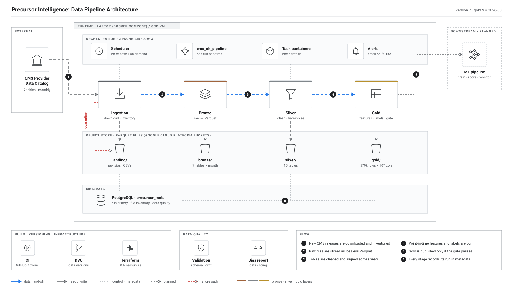
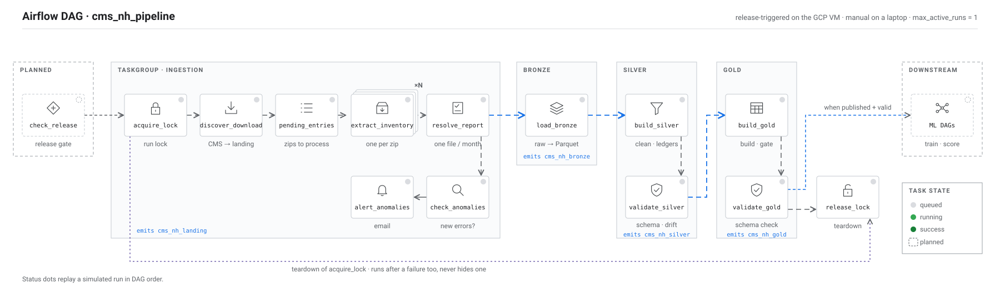
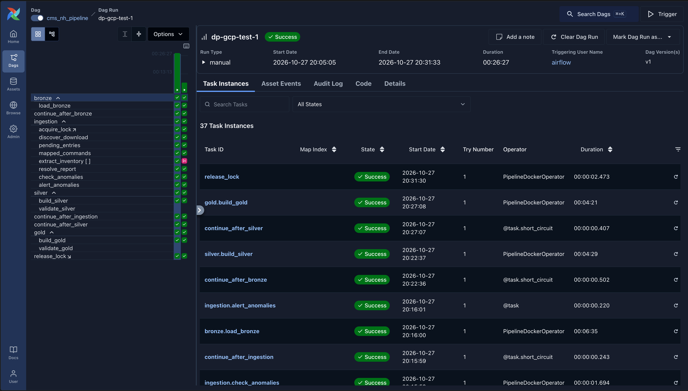
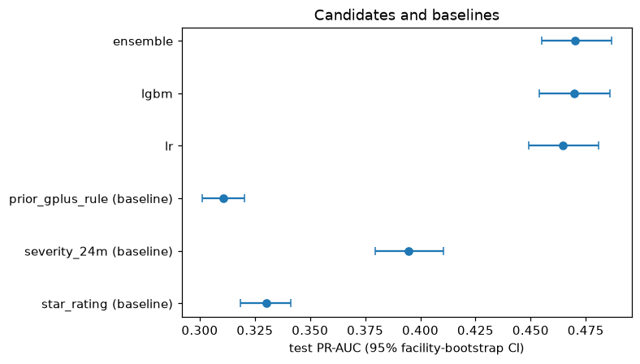
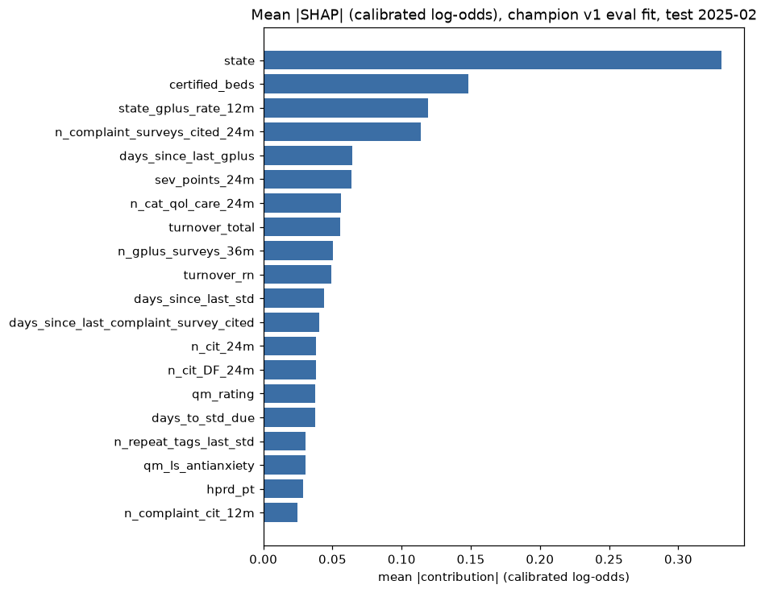
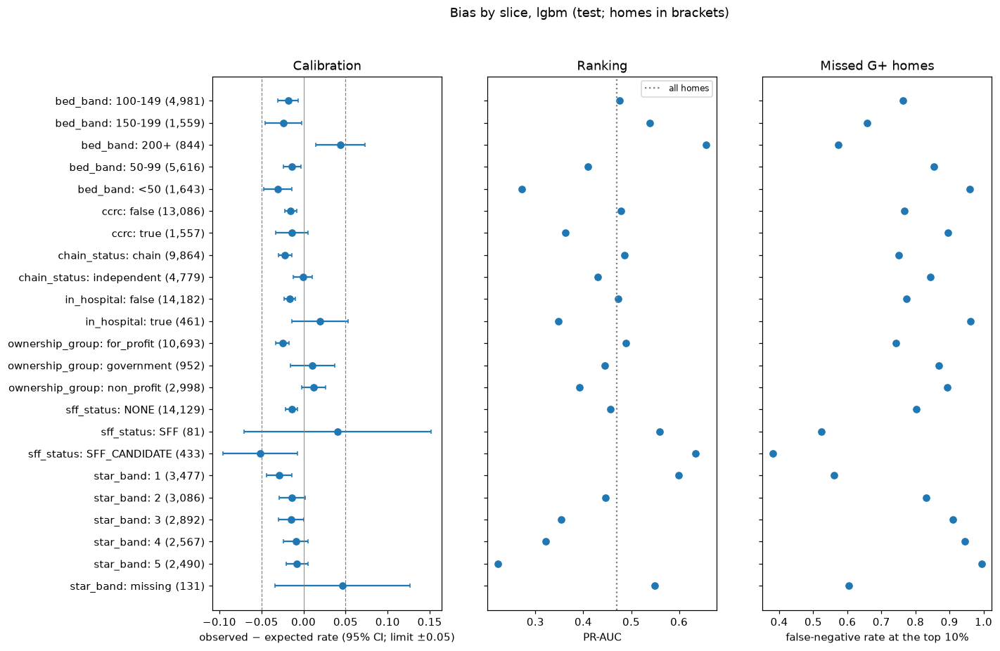
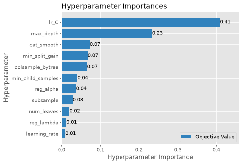

# Precursor Intelligence

An end-to-end MLOps application - Nursing Homes Risk Assessment for the Insurance Industry.

Every month, Precursor Intelligence gives each U.S. nursing home (CMS-certified skilled nursing facility) a
calibrated probability of a **serious health citation (scope/severity G to L) in the next 12 months**, for
long-term-care liability insurers. An Airflow 3 pipeline turns the monthly CMS open-data releases into a
point-in-time training table; LightGBM and four Pydantic AI agents turn that table into calibrated, explained
scores.

> **Status (branch `dev`, November 2026):** the **data pipeline runs end to end**, locally and against the GCS
> bucket: ingestion → bronze → silver → gold, with schema and drift validation, data bias slicing, alerts, DVC and
> CI. **The ML pipeline (Phase 1) is built** (work packages W0 to W6): one Airflow DAG, `cms_nh_ml`, trains, evaluates,
> bias-checks, gates, registers, scores, explains and monitors, with MLflow tracking and a model registry. It runs end
> to end on the real gold on the laptop compose stack against GCS: the first champion was approved on 2026-11-17 and
> scores every home monthly (section 8). Phase 2 moves the ML pipeline to the GCP VM and adds BigQuery, the agents,
> the API and the dashboard.
>
> **Model pipeline:** the architecture in [section 2](#2-architecture), the course requirements and results in
> [section 8](#8-ml-model-development-and-results), how to run it in [section 10.4](#104-run-the-ml-pipeline); the full write-up and
> screenshots in [`docs/ML_PIPELINE.md`](docs/ML_PIPELINE.md).

---

## Contents

1. [What is built](#1-what-is-built)
2. [Architecture](#2-architecture)
3. [The data](#3-the-data)
4. [The pipeline, layer by layer](#4-the-pipeline-layer-by-layer)
5. [The Airflow DAG](#5-the-airflow-dag)
6. [Data validation](#6-data-validation)
7. [Data bias detection and mitigation](#7-data-bias-detection-and-mitigation)
8. [ML model development and results](#8-ml-model-development-and-results)
9. [Storage, metadata and environments](#9-storage-metadata-and-environments)
10. [Getting started](#10-getting-started)
11. [Tests and CI](#11-tests-and-ci)
12. [Data versioning with DVC](#12-data-versioning-with-dvc)
13. [Repository layout](#13-repository-layout)
14. [Documentation map](#14-documentation-map)
15. [Known limitations and next steps](#15-known-limitations-and-next-steps)
16. [Contributing](#16-contributing)

---

## 1. What is built

| Area | What it does | Status |
|---|---|---|
| Ingestion | Discovers and downloads the CMS archive and current release, extracts the 7 in-scope tables, inventories every file and picks one per table and month | Built |
| Bronze | Every selected file as lossless, all-text Parquet per table and month, with lineage and content hashes | Built |
| Silver | Harmonised column names and types across six years of CMS renames; event ledgers; facility universe; calibration of label buffers | Built |
| Gold | Point-in-time spine, 6 feature families (incl. CMS quality measures), labels, splits and the training table; a quality gate before promotion | Built |
| Validation | Pandera schema contracts and month-over-month drift checks on silver and gold, inside the DAG | Built |
| Bias slicing | Representation, label-rate disparity, home-level significance tests, inspector (state) effects, missingness, censoring and drift per slice; train-only sample weights | Built (CLI) |
| Orchestration | One Airflow 3 DAG, one Docker container per task, run lock with teardown, exit-code retries, email alerts | Built |
| Cloud | Runs against `gs://precursor-intel-mlops-data`, one folder per layer; Terraform for GCP | Built |
| Reproducibility | DVC test pipeline, deterministic outputs, manifests with sha256s, CI on Python 3.11 and 3.12 | Built |
| Release gate | `check_release`: run only when CMS publishes something new | Done: DAG `cms_nh_release_check`, hourly, paused until production |
| ML training and selection | LightGBM, logistic regression and their ensemble, Platt-calibrated out of fold; chosen on training data after a bias check | Built (W1) |
| ML evaluation, bias and gates | Held-out metrics with bootstrap CIs, baselines, Fairlearn slices, the reweighting trade-off, 7 deterministic gates, a model card | Built (W2) |
| Explanations and scoring | Exact SHAP: global importance and the top reasons of every home; scores and chain roll-up published to GCS | Built (W3) |
| ML platform | MLflow tracking and model registry (compose service, artifacts in GCS), images, the whole ML chain in CI | Built (W4) |
| ML orchestration | DAG `cms_nh_ml`: decide (retrain, score, skip), promote and rollback, PSI drift monitoring, a run-summary email | Built (W6) |
| Phase 2 | The ML pipeline on the GCP VM, BigQuery, the four agents, the API and the dashboard | Next |

**Latest real run (gold V = 2026-08):** 578,975 home-months × 107 columns, 15,274 homes, 39 monthly partitions
(t = 2023-01 → 2026-08). A full backfill through Airflow into the GCS bucket ran 37/37 tasks green in 26.5 min and
gave gold byte-identical to the local-disk run of the same zips (PR #30).

**ML gold and model (`ml-dev/`, V = 2026-10, rows from 2022-01):** 775,400 home-months × 148 columns, 52 months. The
champion (v1, LightGBM) scores PR-AUC 0.470 (95 % CI 0.454 to 0.486) on the held-out month 2025-02, 1.8 times the base
rate, and scores all 14,686 homes for 2026-10; in PR #49's training window the recipe reproduces the team's best
exploration model (0.481); section 8.

---

## 2. Architecture



*The data pipeline. Numbered steps: 1 new CMS releases are downloaded and inventoried · 2 raw files are stored as
lossless Parquet · 3 tables are cleaned and aligned across years · 4 point-in-time features and labels are built ·
5 gold is published only if the gate passes · 6 every stage records its run in metadata. Dashed parts are planned;
the moving dashes show the direction of the data flow.*



*The ML pipeline, DAG `cms_nh_ml`, built in work packages W0 to W6. Numbered steps: 1 new gold arrives and `decide`
picks retrain, score or skip (or, by hand, re-tune or promote) and pins that gold run · 2 leakage-safe windows, facility-grouped folds and
frames are cut · 3 LightGBM, logistic regression and their ensemble are trained, Platt-calibrated and one is picked
after a bias check · 4 held-out metrics, bias slices, SHAP and a model card are logged to MLflow · 5 deterministic
gates decide `@champion` or `@challenger` · 6 the champion scores every facility with reasons and chain roll-ups ·
7 scores are published and drift monitoring writes the status and emails a summary. The highlight moving across the
stages follows one monthly run; dashed parts are Phase 2. What is built and the results: [`docs/ML_PIPELINE.md`](docs/ML_PIPELINE.md);
the design: [`docs/ML_PIPELINE_SPEC.md`](docs/ML_PIPELINE_SPEC.md).*

**How the ML pipeline works.** The data pipeline ends at gold, a point-in-time training table. The ML pipeline
starts there and turns gold into a calibrated, explained risk score for every nursing home, every month. It is
one Airflow DAG, `cms_nh_ml`, triggered when the data pipeline publishes gold (asset `cms_nh_gold`) or by hand.

| Step | Stage | Built in | What it does |
|---|---|---|---|
| 1 | Decide and pin | W6, W0 | Checks what changed: new matured labels or new code → **retrain**; only new features → **score**; nothing new → **skip**. Re-tune (`mode=retune`, `ml tune` alone) and promote (`mode=promote`) are run by hand; `auto` never picks them. Pins the gold run it reads, so a later data run cannot change its input mid-run |
| 2 | Prepare | W0 | Cuts leakage-safe windows (the evaluation gap equals the production lag: 12-month horizon plus 8-month posting buffer = 20 months), facility-grouped folds (a home is never on both sides of a split) and the training frames |
| 3 | Train and select | W1 | Trains LightGBM, logistic regression and their ensemble, Platt-calibrates each on out-of-fold predictions, and picks one on training data only, after a bias check |
| 4 | Evaluate | W2 | Scores the chosen model on the newest matured months it never saw: PR-AUC against the base rate (about 26 %), precision@5 % and @10 %, Brier, ECE and the course metrics; bias slices, SHAP and a model card, all logged to MLflow |
| 5 | Gate and promote | W2 | Deterministic gates in code (`evaluation/gates.py`), not judgment. All pass and a champion exists → `@champion` in the MLflow registry; otherwise it stays `@challenger`, the current champion keeps scoring and an email goes out. The first version (`gates.first_run: challenger`) and any rollback are promoted by hand with `mode=promote` (Checkpoint ML-A) |
| 6 | Score and explain | W3 | The champion scores every facility for the newest month, with its top SHAP reasons, and rolls the scores up to chains |
| 7 | Publish and monitor | W3, W6 | Scores go to GCS, the source of truth (BigQuery in Phase 2). PSI drift monitoring writes `status/latest.json` and emails a run summary; high drift emails a **re-tune request** (the teal wire to Notify), and a person runs `mode=retune` to tune with Optuna |

- **Batch, not online.** CMS publishes once a month, so scores are computed once a month and stored. There is no
  model server; "deploying" a model means moving the `@champion` alias.
- **Same image, thin DAG.** Every task runs `precursor-pipeline ml <command>` in the same `precursor-pipeline`
  image as the data pipeline; the memory-heavy steps (`train`, `tune`, `evaluate`) share the `heavy` pool's one
  slot with gold's build (W4, W6).
- **Behaviour lives in config.** Windows, thresholds and feature excludes are in `configs/ml.yaml`; the feature
  list comes from `configs/feature_registry.yaml`, so new features (such as W5's quality family: 41 features, 33 of them used) change the
  model by config, not code.
- **Idempotent and auditable.** Runs are keyed on gold's `dataset_version` and a `recipe_hash` and are seeded, so a
  rerun gives the same models. Every promotion, hold and rollback is a row in `ml_runs` and a tag in MLflow.
- **The test window is looked at once.** It is used to report and gate, never to choose.

In one line: gold in → decide → prepare → train → evaluate → gate → score → publish and monitor → scores out, with
MLflow tracking every step and drift asking a person to re-tune.

**Shared by both pipelines:**

- **Files stay files.** Every layer is Parquet on one object store: local disk in development, Google Cloud Storage
  in test and production. All I/O goes through the `ObjectStore` / `TableSink` ports, so the same code runs on
  both. No database for intermediate layers.
- **DAGs are thin.** Every task runs exactly one CLI command (`precursor-ingest …` or `precursor-pipeline …`) in
  the `precursor-pipeline` image. The same commands run by hand, in tests and in Airflow.
- **Behaviour lives in `configs/`**, logic in `src/precursorintelligence/`, wiring in `dags/`.
- **Laptop = GCP.** The compose file, images and DAG are identical; only `docker/airflow-local/.env` differs.

The full write-up, with every component, path and table: [`docs/DATA_PIPELINE_SPEC.md`](docs/DATA_PIPELINE_SPEC.md)
and [`docs/AIRFLOW_PIPELINE.md`](docs/AIRFLOW_PIPELINE.md).

---

## 3. The data

### 3.1 Source

CMS Provider Data Catalog, nursing homes: the archive of monthly releases plus the current release and the
metastore API. Vintages **2021-01 → 2026-08** (66 monthly archive zips, plus the current release). The month a release describes is read from the
`Processing Date` inside each file, never from the zip name. CCN (the facility id) is always 6-character text.

| CMS table | Grain | Used for |
|---|---|---|
| Provider Information | home × release | Facility universe; facility, staffing, turnover and status features |
| Health Deficiencies | one citation | Citation-history features; the G to L labels |
| Inspection Dates | one survey | When the next inspection is due |
| Penalties | one penalty | Enforcement features; penalty labels |
| MDS Quality Measures | home × measure × release | Clinical-risk features (family pending approval) |
| Medicare Claims Quality Measures | home × measure × release | Hospitalisation and ED-visit features (pending) |
| Citation Code Look-up | one F-tag | Tag → category and description |

### 3.2 Targets

| Label | Definition | Role |
|---|---|---|
| `y_g12` | Any health citation with scope/severity **G to L** on a survey in the next **12 months** | Primary model |
| `y_g6` | The same over 6 months | Between-renewal early warning |
| `y_pen12` | Any fine or payment denial in the next 12 months | Built for comparison; role open |

### 3.3 The two leakage rules

1. **Features** for month t use only what CMS had published in the release of month t (plus t−6 and t−12 for
   change features), with `event_date <= cutoff_date`.
2. **Labels** count only events strictly after `cutoff_date` and within the horizon, from **event ledgers** that
   union every release (closed homes and old inspection cycles drop out of later files). A label is final only
   after its maturity buffer: **8 months for citations, 12 for penalties**, measured on the archive.

Both rules are enforced in gold and tested in `tests/leakage`.

### 3.4 Gold training table (`gold/facility_month_dataset`, partitioned by t)

| Column group | Columns | Notes |
|---|---|---|
| Keys and date | `ccn`, `t`, `cutoff_date` | One row per home and month |
| Survey timing | 9 | Days since / until the standard survey, overdue flag, survey counts |
| Citations | 26 | Counts by severity band and category, severity points, worst severity on recent surveys |
| Enforcement | 7 | Fines and payment denials: counts, amounts, recency |
| Facility and staffing | 47 | Beds, ownership, hours per resident day, turnover, CMS footnotes, 6- and 12-month changes |
| Context | 6 | The state's G+ rate and median staffing, the home relative to its state, rating era |
| Labels, status, splits | 9 | `y_*`, `status_*` (positive / negative / immature / censored), `split_*` |

95 registered features (`configs/feature_registry.yaml`): 90 `model`, 4 `ablation_only` (star ratings, never
features), 1 `product_only` (`chain_id`). Splits for `y_g12` at V = 2026-08: train 90,419 · calib 44,959 ·
purge 163,584 · test 29,621 · score 250,392 rows; a purge gap of H months separates train from test because the
label windows overlap.

Every gold run also writes the same rows, columns and dtypes as **one file**, `gold/facility_month_dataset.parquet`
(sorted by `t`, then `ccn`), for readers that want a single file. It is rebuilt in full each run, never appended to
(revised history, matured labels and moved splits change earlier months), promoted with the other outputs, and its sha256
is in `gold/_current.json` and under `merged_file` in `dataset_manifest.json`.

---

## 4. The pipeline, layer by layer

| Layer | Command | Reads | Writes | Metadata |
|---|---|---|---|---|
| **Ingestion** | `precursor-ingest step1 …` | CMS archive, current release, metastore | `landing/cms_nh/{catalog,zips,extracted}/`, `quarantine/` | catalog, source_datasets, download_log, extracted_files, inventory, anomalies |
| **Bronze** | `precursor-pipeline bronze` | selected inventory rows, landing CSVs | `bronze/<table>/vintage=YYYY-MM/` (7 tables) | bronze_files, vintage_flags |
| **Silver** | `precursor-pipeline silver [--calibrate]` | bronze; column map, keep-lists, value maps | 15 silver tables, ledgers, universe, `gold/dim_facility_latest` | silver_partitions |
| **Gold** | `precursor-pipeline gold` | silver, ledgers; labels, splits, feature registry | `gold/` spine, features, labels, dataset (per month and as one merged file), `_current.json`, manifest | run_log |

- **Ingestion:** checksums and size checks; failed downloads go to `quarantine/`, never to landing; one file per
  table and month is selected; a Checkpoint 1 report and anomaly alerts.
- **Bronze:** refuses to start while any inventory row is pending; flags releases CMS republished without changes
  (`stale_refresh`, e.g. 2025-09).
- **Silver:** maps every raw header to one canonical name by vintage range (checked against all 427 selected
  files); unions events into ledgers; in backfill, measures posting lag to set the maturity buffers.
- **Gold:** builds in `gold/_staging/run=<id>/`, then runs a gate (structure, label logic, leakage, coverage).
  Any failed check is exit 2 and nothing is published; on a pass, gold is promoted and `gold/_current.json`
  records each file's sha256.

**Gold is rebuilt, not appended.** Every run recomputes the whole table from silver, so a new month is never just added at
the bottom: old rows change when new data arrives.
- **Labels mature.** A row that is `immature` today (its 12-month window is still open) becomes positive or negative later;
  appending would leave the old "unknown" in place for ever.
- **Splits move.** Each new V shifts the train / calibration / purge / test windows, so many old rows change their split.
- **CMS revises history.** Citations are corrected or removed, which changes older features.

Rows that did not change come out byte-identical, so a full rebuild is cheap to check (the sha256s in `gold/_current.json`).

---

## 5. The Airflow DAG

One DAG, `cms_nh_pipeline` (Airflow 3, `max_active_runs=1`): manual on a laptop; on the GCP VM, started by the hourly release check `cms_nh_release_check` when CMS has new data (or by hand).



*Every task of the DAG, grouped by TaskGroup. Blue arrows hand an Airflow asset to the next group; the purple
dotted line is `release_lock`, the teardown of `acquire_lock`. The status dots replay a simulated run in DAG order
(they are not live Airflow state). Dashed tasks are planned.*



*The Airflow Gantt chart of a successful `cms_nh_pipeline` run on GCP: every task's start and duration, with all
layers written to the GCS bucket.*

```
acquire_lock → discover_download → pending_entries → extract_inventory[one per zip] → resolve_report
  → check_anomalies → alert_anomalies                                    (asset cms_nh_landing)
  → load_bronze                                                          (asset cms_nh_bronze)
  → build_silver → validate_silver                                       (asset cms_nh_silver)
  → build_gold → validate_gold                                           (asset cms_nh_gold)
release_lock = teardown of acquire_lock (runs after a failure too)
```

| Mechanism | How it works |
|---|---|
| Run lock | `data_pipeline` lock in `run_lock`; one run at a time; stale after 12 h |
| Teardown | `release_lock` is an Airflow teardown of `acquire_lock`, so a failed run still shows as failed |
| Exit codes | 0 ok · 1 error (retried 2 × 5 min) · 2 bad data / validation · 3 bad config (2 and 3 fail at once) |
| Mapping | `extract_inventory` is mapped, one copy per pending zip, up to 3 in parallel |
| Assets | `cms_nh_landing` → `cms_nh_bronze` → `cms_nh_silver` → `cms_nh_gold` (only when gold publishes and validates) |
| Alerts | Email (`PI_ALERT_EMAIL_TO`): every failed run, a failed `release_lock`, new error anomalies, a CMS release stuck partial for 3 days or a release the pipeline never started (`cms_nh_release_check`) |
| Params | `mode` (monthly / backfill), `calibrate`, `stop_after` (node by node), `entry_ids` (development) |
| Run modes | Monthly: only new or changed inputs; gold rebuilds and recomputes every label. Backfill: everything plus calibration |

### 5.1 Pipeline flow optimisation

The Gantt chart above (a full backfill of 23 zips into the GCS bucket, 37 tasks, 26.5 min) shows where the time goes:

| Task group | Time | Note |
|---|---|---|
| Download | 95 s | mapped, up to 3 zips in parallel |
| Bronze | 396 s | **the bottleneck**: one task for every table and month; peak memory about 2.3 GB |
| Silver | 270 s | one task, plus calibration in a backfill |
| Gold | 262 s | rebuilt in full each run; peak memory about 2.2 GB on the subset |

What already speeds a run up (measured in [`docs/runbooks/airflow-local.md`](docs/runbooks/airflow-local.md) §8.2, local disk):
- **Only new or changed inputs are processed.** A monthly run skips every zip and file it already has: a rerun of 23
  already-processed zips took 56 s, against 107 s for the first load of 14, and bronze and silver outputs are byte-identical.
- **Parallel per-zip extraction** (`extract_inventory` is mapped, up to 3 at once).
- **`stop_after`** runs a node at a time, and a monthly run validates only the latest silver month.

The next step would be to split bronze by table so its tasks run in parallel; it is not built yet.

Details and the metadata schema: [`docs/AIRFLOW_PIPELINE.md`](docs/AIRFLOW_PIPELINE.md). Running it:
[`docs/runbooks/airflow-local.md`](docs/runbooks/airflow-local.md).

---

## 6. Data validation

`precursor-pipeline validate --layer silver|gold` checks a layer month by month and changes nothing.

- **Schema (Pandera, `configs/contracts/<table>.yaml`):** missing or unexpected columns, types, nulls, ranges,
  allowed values, the CCN pattern, unique keys, and label consistency (`y` null exactly when immature or
  censored, `split = score` exactly when immature).
- **Drift vs the previous month (`configs/validation.yaml`):** row-count change, null-rate jumps, mean shifts.
- **In the DAG:** `validate_silver` runs before gold, so bad silver never reaches gold; `validate_gold` runs after
  `build_gold` and emits `cms_nh_gold`. A schema violation is exit 2; drift is a warning. Every anomaly is a row
  in `dq_results`.

**Why Pandera, not Great Expectations or TFDV:** Pandera is already a dependency of the pipeline image and validates
Polars frames natively, so there is no conversion and no extra service. The schema is one reviewable YAML file per
table. Great Expectations and TFDV would each add a heavy dependency and their own store for expectations and
statistics; here the statistics are plain JSON reports and `dq_results` rows next to the other nodes' outputs.

Details: [`docs/VALIDATION.md`](docs/VALIDATION.md).

---

## 7. Data bias detection and mitigation

`precursor-pipeline bias-report` slices gold and checks whether some kinds of homes are represented, labelled or
measured differently, before any model exists. Slices are facility attributes and state inspection practice
(CMS facility data has no person-level demographics): state, CMS region, ownership, bed band, chain status,
in-hospital, CCRC, SFF status and star band, plus crossings (including star band × rating era).

| Check | Method |
|---|---|
| Representation | Rows and homes per slice; small slices (under 30 homes or 500 labelled rows) are reported, never ranked |
| Label-rate disparity | Rate per slice against the rest, Wilson intervals, four-fifths ratio |
| SliceFinder testing | Cohen's h and a z-test with **home-clustered variances** (a home's labels are correlated across months), Benjamini-Hochberg FDR; risk tiers (SFF, star band) are never "problematic" |
| Inspector (rater) effects | Per state: label rate vs inspection frequency and backlog, citing severity, past rate (persistence) |
| Missingness and censoring | Null-rate and closed-home gaps per slice |
| Drift per slice | Flagged only beyond what random same-size samples of all homes show |
| Mitigation | Sample weights fit on training rows only (`sample_weights.parquet`); gold is never changed |

**Findings on real gold (V = 2026-08):** state is the strongest slice and partly a measurement effect (Illinois
62.8% vs 25.3% elsewhere; its inspectors cite more often and more severely). Ownership, size and setting differ
but below the effect-size threshold. With states shuffled between homes, the test finds 0 significant states in
20 of 20 runs. Mitigation decisions are proposals for team sign-off (#27).

Write-up: [`docs/bias/findings.md`](docs/bias/findings.md); method and outputs: [`docs/bias/README.md`](docs/bias/README.md).

---

## 8. ML model development and results

The course's model-development deliverable in short. The full write-up, with the method, every chart and the runs
behind the numbers: [`docs/ML_PIPELINE.md`](docs/ML_PIPELINE.md). Stage numbers refer to the ML diagram in section 2.

| Guideline | How it is met | Stage |
|---|---|---|
| Load versioned pipeline data | `ml prepare` pins gold's `_current.json`, checks the merged file's sha256 and records `dataset_version` | 1, 2 |
| Train and select | LightGBM, logistic regression and their log-odds ensemble, each Platt-calibrated out of fold; the highest out-of-fold PR-AUC among the candidates that pass a bias check | 3 |
| Validate on held-out data | the test month no step trains, tunes or selects on: PR-AUC, ROC-AUC, accuracy, precision, recall, F1, precision@k, Brier, ECE, with facility-bootstrap CIs and three baselines | 4 |
| Bias detection and mitigation | Fairlearn per slice value (ownership, size, chain, hospital-based, state, ...): calibration gap O−E, PR-AUC, false-negative rate; gate G7; the reweighting trade-off on every run, applied with `bias.mitigation: reweight` | 4, 5 |
| Hyperparameter tuning | Optuna TPE on 3 facility-grouped folds, search space in `configs/ml.yaml` (`ml tune`, `mode=retune`) | side task |
| Tracking and registry | one MLflow run per task (params, metrics, models, plots); registry `precursor_y_g12` with `@champion` and `@challenger` | 3 to 6 |
| Sensitivity | exact SHAP: global importance and every home's top 5 risk-raising and top 3 risk-lowering features; Optuna hyperparameter importances | 4, 6 |
| CI/CD, alerts, rollback | the whole chain on a synthetic gold on every pull request (a held gate fails CI); an email for every run; rollback = promote an earlier version | 5, 7 |
| Docker | every step is `precursor-pipeline ml <command>` in the `precursor-pipeline` image | all |

**Results on the real gold** (held-out month 2025-02: 14,643 homes, 25.6 % with a G to L citation within 12 months):

| Model | Training window | PR-AUC (95 % CI) | ROC-AUC | Brier | ECE | Precision@5 % |
|---|---|---|---|---|---|---|
| **Champion v1: LightGBM, 119 features** (in production on the stack) | production: 2022-05 to 2023-04, the same 20-month lag as live scoring | **0.470 (0.454-0.486)** | 0.706 | 0.171 | 0.028 | 0.643 |
| Ensemble, 120 features (reproduction) | PR #49's: 2023-01 to 2023-11 | 0.481 (0.465-0.498) | 0.710 | 0.169 | 0.026 | 0.676 |
| PR #49's ensemble, 133 features | PR #49's | 0.481 (0.465-0.499) | 0.709 | 0.169 | 0.027 | 0.682 |
| Best baseline: 24-month citation severity | | 0.395 (0.380-0.410) | 0.657 | | | |

- **The champion** beats every baseline (by +0.159 PR-AUC over the prior-G+ rule) and passed every gate. It was
  approved at Checkpoint ML-A on 2026-11-17 and scores all 14,686 homes for 2026-10, with reasons and chain roll-ups.
- **The baseline model is reproduced** in its own window, with fewer features. The production window scores a little
  lower because its data is 7 months older, as live scoring's is.
- **End to end on the stack** (spec §17.2, all passed):
  - a run with nothing new skips;
  - a rescore is identical;
  - a re-tune runs alone;
  - a second version was promoted automatically through all seven gates;
  - a deliberately weak candidate was held;
  - a rollback moved the champion back.

  Every run emails its summary.
- **Bias:** no gated group is clearly miscalibrated (no O−E 95 % CI wholly outside ±0.05). Reweighting by ownership
  would cost 0.006 out-of-fold PR-AUC and widen the largest gap (0.016 to 0.022), so it stays off; the trade-off is
  in every model card.
- **Tuning:** two runs of 30 trials, all between 0.509 and 0.511; tree depth and LR's `C` matter most, so the base
  parameters stay (a proposal is applied only through a reviewed PR).
- **What drives the score:** the home's state and the state's recent G+ rate, its size, and its own complaint and
  citation history; staffing and quality measures add the rest.
- **Caveat:** labels mature 20 months after `t`, so 2025-02 is the newest test month, and PR #49 chose its settings on
  it. Checkpoint ML-A (2026-11-17) read 2025-02, the only test month so far; it is re-read on 2025-03, the first honest
  month, when the next CMS release (due 2026-12-02) brings it in.

<table>
<tr>
<td></td>
<td></td>
</tr>
<tr>
<td></td>
<td></td>
</tr>
</table>

*From the champion's runs: candidates and baselines on the test month; the top 20 features by mean |SHAP|; bias by
slice (calibration gap with its CI against ±0.05, PR-AUC, false-negative rate at the top 10 %); hyperparameter
importances from the DAG's re-tune.*

Screenshots of MLflow (runs, model card, registry), Airflow (the DAG runs) and the run emails: [`docs/ML_PIPELINE.md` §14.1](docs/ML_PIPELINE.md#141-screenshots-from-the-stack). To run it: section 10.4.

---

## 9. Storage, metadata and environments

**Object store layout** (`./data` locally, `gs://precursor-intel-mlops-data` in GCP; one folder per layer):

```
landing/cms_nh/{catalog,zips,extracted}/   quarantine/cms_nh/<run_id>/
bronze/<table>/vintage=YYYY-MM/            silver/<table>/…
gold/<table>/t=YYYY-MM/  gold/facility_month_dataset.parquet  gold/_current.json  gold/dataset_manifest.json  gold/_staging/
reports/<node>/run=<run_id>/  reports/<node>/latest/   metadata/<layer>/run_date=…/
```

**Metadata:** Postgres database `precursor_meta` (SQLite only for single-process CLI runs and unit tests):
catalog, source_datasets, download_log, extracted_files, inventory, anomalies, bronze_files, vintage_flags,
silver_partitions, dq_results, run_log, run_lock, vintage_registry. Airflow keeps its own state in a separate database.

| Setting | Laptop | GCP VM |
|---|---|---|
| `PI_PIPELINE_ENV` | `dev` → `configs/dev.yaml` (local disk) | `prod` → `configs/prod.yaml` (GCS, object versioning) |
| Credentials | none, or `PI_GCP_CREDENTIALS_FILE` to run against the bucket | the VM's service account `sa-pipeline` (no key files) |
| Schedule | manual | `cms_nh_release_check` (hourly) starts a run when CMS has new data |
| Task memory | no limit | 6 GB per task container |

Task containers sit on their own Docker network: they reach only Postgres and the internet (they open untrusted
zips), never the Airflow API or the Docker API.

---

## 10. Getting started

**Requirements:** Python 3.11 or 3.12, [`uv`](https://docs.astral.sh/uv/) 0.13 or newer (never pip; `uv.lock` uses the newer lockfile format, so an older uv fails `uv sync --frozen`: `uv self update`), Docker for Airflow, and about 2 GB of
free disk for the sample runs below (25 GB for a full-archive run). People who need pip can use `requirements.txt`, the same
pinned versions as `uv.lock` (`pip install -r requirements.txt`); CI fails if the two drift apart.

```bash
uv sync --all-extras                   # exact versions from uv.lock, every extra, dev tools
uv run python --version                # must be 3.11.x or 3.12.x
```

> **Start with a sample.** With no filter, ingestion fetches every in-scope zip: 66 monthly archive zips plus the current
> release, about 2.5 GB downloaded and 18 GB extracted, 20+ minutes. Select zips with `--zip-dates` or `--entry-ids`
> (`uv run precursor-ingest step1 --help`); in Airflow, always pass `entry_ids`.

### 10.1 Run the pipeline from the CLI

Local disk under `./data` (git-ignored), process logs under `./logs/`; each step is one DAG task:

```bash
uv run precursor-ingest step1 --zip-dates 2025-07-30,2025-09-24   # two releases: discover, download, extract, inventory, resolve, report
uv run precursor-pipeline bronze                                    # landing → bronze
uv run precursor-pipeline silver                                    # bronze → silver (--calibrate in a backfill)
uv run precursor-pipeline validate --layer silver                   # schema + drift checks
uv run precursor-pipeline gold                                      # silver → gold, behind the gate
uv run precursor-pipeline validate --layer gold
uv run precursor-pipeline bias-report                               # → reports/bias/
```

Gold needs enough history for a training month, so with only two zips it stops at its gate (exit 2, nothing published, by
design). The Airflow sample below (14, then 19 zips) reaches a published gold.

### 10.2 Run it in Airflow (laptop, real CMS downloads, about 1 GB)

Build the three images from the repo root (the pipeline and MLflow images need the commit they were built from), then create
`docker/airflow-local/.env` with fresh secrets and start the stack:

```bash
docker build -f docker/pipeline.Dockerfile --build-arg PI_GIT_SHA=$(git rev-parse HEAD) -t precursor-pipeline:latest .
docker build -f docker/airflow.Dockerfile -t precursor-airflow:latest .
docker build -f docker/mlflow.Dockerfile --build-arg PI_GIT_SHA=$(git rev-parse HEAD) -t precursor-mlflow:latest .
cd docker/airflow-local
cat > .env <<EOF
AIRFLOW_DB_PASSWORD=$(openssl rand -hex 16)
PI_META_DB_PASSWORD=$(openssl rand -hex 16)
AIRFLOW_JWT_SECRET=$(openssl rand -hex 32)
AIRFLOW_FERNET_KEY=$(openssl rand -base64 32 | tr '+/' '-_')
MLFLOW_DB_PASSWORD=$(openssl rand -hex 32)
AIRFLOW_UID=$(id -u)
PI_PIPELINE_ENV=dev
PI_HOST_DATA_DIR=$HOME/pi-data
PI_TASK_MEM_LIMIT=
PI_AUTO_REMOVE=success
EOF
chmod 600 .env && mkdir -p "$HOME/pi-data"
docker compose up -d --wait --pull never
docker compose exec airflow-scheduler airflow dags unpause cms_nh_pipeline
```

- `PI_PIPELINE_ENV=dev` keeps all data in the `PI_HOST_DATA_DIR` folder; no cloud credentials are needed.
- Nothing starts a run on its own: `cms_nh_pipeline` runs on the `cms_nh_release` asset, which only the hourly `cms_nh_release_check` emits, and that DAG is created paused. Keep it paused on a laptop and trigger runs by hand.
- The UI is at http://localhost:8080, user `admin`; the password:
  `docker compose exec airflow-apiserver cat /opt/airflow/config/simple_auth_manager_passwords.json`.

Trigger the two sample runs (14 and then 19 zips):

```bash
A=""; for z in 2021-07-27 2021-10-27 2021-11-27 2022-01-27 2022-06-27 2023-01-02 2023-06-27 2023-09-02 2024-06-26 2024-09-26 2024-12-20 2025-02-26 2025-07-30 2025-09-24; do A="$A${A:+,}theme:$z:nursing-homes_$z.zip"; done
B="$A"; for z in 2025-11-20 2026-01-14 2026-02-25 2026-06-24 2026-07-29; do B="$B,theme:$z:nursing-homes_$z.zip"; done

# Run 1 (about 2 minutes): ends failed on purpose, see below
docker compose exec airflow-scheduler airflow dags trigger cms_nh_pipeline --run-id sample-1 \
  --conf "{\"mode\": \"backfill\", \"entry_ids\": \"$A\"}"
# Run 2, once run 1 has finished: fully green, gold is published
docker compose exec airflow-scheduler airflow dags trigger cms_nh_pipeline --run-id sample-2 \
  --conf "{\"mode\": \"monthly\", \"entry_ids\": \"$B\"}"
```

Run 1 fails at `build_gold` with exit 2, which is the pipeline working as designed: its last month is a stale CMS refresh,
so gold has no training month yet, nothing is published, the lock is released and the run is marked failed. Run 2 adds
months and every task is green, including `validate_gold`. Stop the stack with `docker compose down -v`.
More runs, checks and the GCP setup: [`docs/runbooks/airflow-local.md`](docs/runbooks/airflow-local.md); the GCP VM:
[`docs/runbooks/gcp-bootstrap.md`](docs/runbooks/gcp-bootstrap.md).

### 10.3 Reproducing it on another machine

1. `git clone` the repo, then `uv sync --all-extras` (or `pip install -r requirements.txt` in a fresh virtual environment).
2. `uv run pytest`: the offline tests pass, with no network or credentials.
3. `uv run dvc repro`: the test pipeline rebuilds with the hashes recorded in `dvc.lock` (byte-identical on macOS and Linux).
4. Optional, with a Google account that can read the DVC bucket: `gcloud auth application-default login`, then `uv run dvc pull`.
5. Airflow: section 10.2.

Real runs download from the public CMS archive and need no credentials; cloud credentials are needed only for the two GCS
buckets. The tests and the test pipeline need nothing but the install.

**Memory:** a full gold build peaks at about 4 to 5 GB; bronze at about 2.2 GB. On an 8 GB laptop, start with at least
2.5 GB free.

**Windows:** use Git Bash with POSIX commands, run tests with `uv run pytest -p no:cacheprovider --basetemp=C:/pt`
(the default temp path exceeds the 260-character limit), and run the CLI without `--run-id` (`:` is illegal in
Windows file names).

### 10.4 Run the ML pipeline

```bash
uv run dvc repro --force --single-item toy_ml    # the whole ML chain offline on a synthetic gold: no credentials
```

On the real gold step by step (`precursor-pipeline ml prepare | train | evaluate | gate ...`), and in Airflow
(DAG `cms_nh_ml`: `retrain`, `promote` after Checkpoint ML-A, rollback, `retune`):
[`docs/ML_PIPELINE.md`](docs/ML_PIPELINE.md) section 13 and [`docs/runbooks/airflow-local.md`](docs/runbooks/airflow-local.md).

---

## 11. Tests and CI

```bash
uv run ruff check src tests && uv run mypy src
uv run pytest                          # 1,500+ offline tests; live CMS tests are skipped
uv run pytest -n auto --dist loadfile  # the same on all cores (CI runs 4 workers)
uv run pytest tests/leakage            # the leakage suite
```

- **CI (GitHub Actions, `.github/workflows/ci.yml`):** ruff, the offline suite on 4 workers and `dvc repro` of the
  test pipelines, on Python 3.11 and 3.12, running only the tests a PR needs: none for docs or infra changes, the ML
  tests for ML-only changes, everything otherwise (about 7 to 8 minutes). The `toy_ml` stage (on 3.12) trains,
  validates, bias-checks, gates, registers (a SQLite MLflow store), scores and publishes on a synthetic gold on every
  PR; a held gate fails it. The `ci-ok` check is required to merge.
- **DAG tests** (`tests/dags`) run inside the official Airflow 3 image: the chain, the only leaf, asset outlets
  and the commands each task runs.
- **Terraform** (`.github/workflows/terraform.yml`): `plan` on PRs, `apply` only in CI.
- **Deploy** (`.github/workflows/deploy.yml`, started by hand: `gh workflow run deploy.yml --ref dev`): points the VM
  at a release whose images CD pushed (`infra/vm/README.md`, "Deploys").

---

## 12. Data versioning with DVC

[DVC](https://dvc.org) versions data the way Git versions code: Git tracks small pointer files (`dvc.yaml`, `dvc.lock`, `metrics/`), and the data itself lives in a DVC cache plus a remote, `gs://precursor-intel-mlops-dvc`, a bucket of its own so nobody needs write access to the production data bucket to share DVC data (created in `infra/terraform/envs/prod`).

What DVC tracks here is the **test pipeline**: a small silver world (`tests/gold/make_toy_silver.py`) is turned into gold by the real `precursor-pipeline gold` node, then summarised into `metrics/toy_gold.json` (`scripts/dvc_gold_summary.py`). The stage's outputs include the merged gold
file `data/toy/gold/facility_month_dataset.parquet`, and `uv.lock` is one of its inputs (parquet files record the writer's library version). It needs no network or credentials, so anyone can rebuild it. (The stage, folder and file names still say `toy`: `toy_gold`, `data/toy/`, `metrics/toy_gold.json`.) A second stage, `toy_ml`, runs the whole ML chain on a synthetic ML gold (`tests/ml/make_ml_gold.py`) into `data/toy_ml/` and summarises each step in `metrics/toy_ml.json` (`scripts/dvc_toy_ml.py`; only the facts that are the same on every machine, so it does not move between a laptop and CI).

```bash
uv sync --all-extras        # includes dvc[gs]
uv run dvc repro            # runs only the stages whose code, configs or inputs changed
uv run dvc status           # "Data and pipelines are up to date" when nothing is stale
uv run dvc dag              # toy_gold -> toy_summary; toy_ml
uv run dvc metrics show     # row and file counts per gold table
```

Share or restore data (needs write or read access to the DVC bucket: `gcloud auth application-default login`):

```bash
uv run dvc push             # upload the cached outputs to the remote
uv run dvc pull             # download the outputs that dvc.lock points to
git checkout <rev> -- dvc.lock && uv run dvc checkout   # restore the data of an older commit
uv run dvc metrics diff <rev>                           # compare the counts with that commit
```

The outputs are byte-stable, so a rebuild on any machine gives the same hashes in `dvc.lock`; CI rebuilds the test pipeline on every PR and warns if `dvc.lock` or `metrics/` changed. If you change anything listed under `deps:` in `dvc.yaml`, run `uv run dvc repro` and commit the new `dvc.lock`, `metrics/toy_gold.json` and `metrics/toy_ml.json` in the same PR, then run `uv run dvc push` (it needs write access to the DVC bucket) so teammates' `dvc pull` finds the new data. CI only runs `dvc repro`, so a missing push is not caught there. `dvc.lock` is deterministic, so if it conflicts on a merge, take either side, run `uv run dvc repro`, and commit the result. On Windows, run `dvc repro` in a checkout with LF line endings (`git -c core.autocrlf=false worktree add …`): DVC hashes raw bytes, and CRLF files give hashes CI does not reproduce.

DVC sits next to, not in place of, the production data versioning: real data is immutable in the bucket (object versioning, never-overwrite landing) and gold is promoted behind `gold/_current.json`, which records each file's sha256 (`docs/GOLD_HANDOFF.md`). The `dvc.yaml` stages are the test pipeline only and declare nothing outside `data/`; the published real gold is versioned separately, as one DVC snapshot per release (section 12.1).

### 12.1 Keeping versions of gold

Because gold is rebuilt in full each run, every release produces a complete new table, and the history has to be kept on
purpose. One DVC snapshot per release does it:
- **What is snapshotted:** the published merged file `gold/facility_month_dataset.parquet` with its `dataset_manifest.json` and
  `_current.json`, copied by `precursor-pipeline snapshot-gold` (the merged file sha256-checked; it refuses an unverified gold
  unless `--allow-unverified`, and one built from a dirty tree unless `--allow-dirty`). `dvc add snapshots/gold_real` makes the
  pointer `snapshots/gold_real.dvc`, which Git tracks; the data goes to the DVC bucket. There is no `dvc.yaml` stage on the real
  data: it would go stale with every code PR.
- **The first snapshot is test data:** `gold-V2026-09-9be058f9-unverified` was built from the 23-zip sample archive (gold run
  `dp-gcp-test-4`), not the full CMS archive. Do not train on it; the first full-archive snapshot replaces the pointer.
- **Restore a version:** `git checkout <tag> -- snapshots/gold_real.dvc && uv run dvc pull snapshots/gold_real.dvc`. DVC stores files by
  content, so unchanged parts are not copied again.
- **Tags:** the PR's squash-merge commit on `dev` (not the tip of `dev`) is tagged with the month and the content hash, `gold-V<V>-<first 8 characters of
  dataset_version>`. The month alone is not a unique version: a rerun for the same V can change rows (a reload, a config
  change, CMS revising history); `dataset_version` in the manifest is the content hash.
- **No month-named copies** such as `facility_month_dataset_2026-09.csv`: they duplicate data, say nothing about the code and
  configs that produced them, and collide when the same month is rebuilt. The latest gold is already one file behind `_current.json`.
- **Parquet stays the stored format.** CSV drops column types and would be several hundred MB; a CSV export for spreadsheet users
  can be added as an extra.
- **A person does it, per release, after a green run.** Airflow never calls DVC or commits to Git. Steps, the checks and the
  restore commands: [`docs/runbooks/gold-snapshot.md`](docs/runbooks/gold-snapshot.md).

---

## 13. Repository layout

```
Precursor-Intelligence/
├── .github/                    # CI/CD workflows, PR and issue templates, CODEOWNERS
├── configs/                    # environment config, dataset registry, schema contracts, prompts
├── src/
│   └── precursorintelligence/  # shared Python package
├── backend/                    # FastAPI service
├── frontend/                   # React app (Vite, TypeScript)
├── dags/                       # Airflow DAGs
├── docker/                     # Dockerfiles and local Airflow compose
├── infra/terraform/            # GCP infrastructure as code
├── scripts/                    # small helper scripts (e.g. the DVC metrics summary)
├── tests/                      # automated tests
├── logs/                       # process logs of local runs (git-ignored)
├── notebooks/                  # exploration only
├── data/                       # local data cache (git-ignored)
├── docs/                       # ADRs, data notes, runbooks
├── snapshots/                  # DVC pointers of the published gold (data in the DVC bucket)
├── dvc.yaml  dvc.lock  metrics/   # DVC pipeline (test), its lock file and metrics
└── pyproject.toml  uv.lock  requirements.txt
```

| Folder | What goes here |
|---|---|
| `.github/` | CI/CD workflows, pull request and issue templates, CODEOWNERS |
| `configs/` | base / dev / prod config, dataset registry, versioned schema contracts, LLM prompts |
| `src/precursorintelligence/` | Shared Python package: `common`, `ingestion`, `harmonize` (bronze, silver), `gold`, `validation`, `bias`, `alerts`, `features`, `training`, `evaluation`, `serving`, `monitoring`, `agents` |
| `backend/` | FastAPI service, using the agents in `src/precursorintelligence/agents`; deployed to Cloud Run |
| `frontend/` | The React app underwriters use (`frontend/README.md`); FastAPI serves its build on Cloud Run (`docs/adr/0001-ui-hosting-and-auth.md`) |
| `dags/` | Thin Airflow DAGs that only trigger jobs (no business logic) |
| `docker/` | One Dockerfile per image, plus the local Airflow compose file |
| `infra/terraform/` | GCP infrastructure: `envs/{dev,prod}` and reusable modules |
| `scripts/` | Small helper scripts, e.g. `dvc_gold_summary.py`; the pipeline's commands are the two CLIs in `src/` |
| `tests/` | Mirrors `src/`, plus `backend/`, `frontend/`, `contracts/` and `dags/`; tiny fixtures only |
| `logs/` | JSON process logs of local runs (`<run id>.jsonl`); the folder is kept with a `.gitkeep`, its contents are git-ignored |
| `notebooks/` | Exploration only; strip outputs before committing |
| `data/` | Git-ignored local cache that mirrors the GCS layout |
| `docs/` | Architecture decision records, data notes, runbooks |
| `snapshots/` | `gold_real.dvc`, the DVC pointer of the published gold (`docs/runbooks/gold-snapshot.md`); the data is git-ignored |

Each top-level folder has its own README describing what belongs there.

The course's example structure maps onto this repository as follows:

| Course example | Here |
|---|---|
| `dags/` | `dags/` |
| `data/` | `data/` (git-ignored local cache that mirrors the GCS layout) |
| `scripts/` | `scripts/`, and the two CLIs in `src/precursorintelligence/` |
| `tests/` | `tests/` |
| `logs/` | `logs/` |
| `dvc.yaml` | `dvc.yaml`, `dvc.lock`, `.dvc/`, `metrics/` |
| `README.md` | this file |

---

## 14. Documentation map

| Document | What it covers |
|---|---|
| [`docs/DATA_PIPELINE_SPEC.md`](docs/DATA_PIPELINE_SPEC.md) | The data pipeline specification: every step, table, rule and decision |
| [`docs/AIRFLOW_PIPELINE.md`](docs/AIRFLOW_PIPELINE.md) | The DAG, run lock, exit codes, metadata database, logs, environments |
| [`docs/STEP1_DATA_INGESTION_PIPELINE.md`](docs/STEP1_DATA_INGESTION_PIPELINE.md) | Ingestion in detail |
| [`docs/BRONZE_CONTRACT.md`](docs/BRONZE_CONTRACT.md), [`docs/SILVER_CONTRACT.md`](docs/SILVER_CONTRACT.md) | Layer contracts |
| [`docs/GOLD_HANDOFF.md`](docs/GOLD_HANDOFF.md) | Gold: build, gate, promotion, `_current.json` |
| [`docs/VALIDATION.md`](docs/VALIDATION.md) | Schema and drift validation |
| [`docs/bias/README.md`](docs/bias/README.md), [`docs/bias/findings.md`](docs/bias/findings.md) | Bias slicing: method, outputs, real-run findings |
| [`docs/ALERTS_HANDOFF.md`](docs/ALERTS_HANDOFF.md) | Failure and anomaly alerts |
| [`docs/ML_PIPELINE.md`](docs/ML_PIPELINE.md) | The ML pipeline as built: course requirements, results, evidence and how to run it |
| [`docs/ML_PIPELINE_SPEC.md`](docs/ML_PIPELINE_SPEC.md) | The ML pipeline specification: every step, gate, decision and work package |
| [`docs/runbooks/`](docs/runbooks/) | Local Airflow (both DAGs), end-to-end simulation, GCP bootstrap |

---

## 15. Known limitations and next steps

- **Release gate:** `cms_nh_release_check` (hourly) runs `check_release` and starts `cms_nh_pipeline` when CMS publishes something new. It stays paused until production starts.
- **Gold is validated after promotion:** `validate_gold` holds back the `cms_nh_gold` asset, but a bad gold is
  already in `gold/`; validating `gold/_staging/` first is the top follow-up (`docs/VALIDATION.md`).
- **Training window:** training rows start in 2022-01 (PR #53), so the ML evaluation window has its 11 months with
  the 20-month production lag. Labels mature 20 months after `t`: the newest test month is 2025-02, a development
  month (PR #49 chose its settings on it). Checkpoint ML-A (2026-11-17) read 2025-02, the only test month so far; it is
  re-read on 2025-03 when the next CMS release (due 2026-12-02) brings it in.
- **Gold memory:** the first full-archive build on the VM (T25) was killed at 10.46 GB, over its 10 GB task limit: gold
  needs about 12-14 GiB at 775,400 rows and 148 columns. The VM is now an e2-highmem-4 (32 GB, 20 GB task limit); the
  streaming fix in `docs/AIRFLOW_PIPELINE.md` §9.1 would bring it back to a smaller machine.
- **Team decisions in #27:** which slices are fairness groups, whether state effects are risk or bias, whether
  sample weights are used by default.
- **Snapshots of real gold:** `snapshot-gold` and the pointer exist (section 12.1). The first snapshot is of the sample archive (test data), and every snapshot is of an unverified gold until the spec §11 verification gate is built.
- **Unverified gold in ML:** `allow_unverified: true` (tagged on every run) until the spec §11 verification gate exists.
- **Next (Phase 2):** the ML DAG and MLflow on the GCP VM, BigQuery publish, the tuned challenger and an automatic
  re-tune, per-state calibration shrinkage, MLflow authentication, the agents, the API and the dashboard
  (`docs/ML_PIPELINE.md` section 15).

---

## 16. Contributing

Branching and the rules before making a pull request to `dev`: [`CONTRIBUTING.md`](CONTRIBUTING.md).
