# The ML pipeline: what is built and what it gives

> **Scope.** This is the model-development deliverable: how the ML pipeline meets each point of the course
> guidelines (`Model_pipeline.pdf`), with the results on the real gold and the evidence behind them.
> **The design and every rule:** [`ML_PIPELINE_SPEC.md`](ML_PIPELINE_SPEC.md) (§ numbers below refer to it).
> **Operating it in Airflow:** [`runbooks/airflow-local.md`](runbooks/airflow-local.md).
> **Status (November 2026):** Phase 1 is built (work packages W0 to W6) and **runs end to end on the real gold** on
> the laptop integration stack (Docker Compose: Airflow 3, MLflow, Postgres) against the GCS bucket's `ml-dev/`
> prefix. The first champion (v1) was approved at Checkpoint ML-A on 2026-11-17 and scores 14,686 homes for 2026-10;
> every acceptance run of spec §17.2 passed on 2026-11-18 (section 14). Phase 2 moves it to the GCP VM, adds
> BigQuery and connects the API, the agents and the dashboard.

---

## Contents

1. [In one page](#1-in-one-page)
2. [Architecture](#2-architecture)
3. [Course requirements and where they are met](#3-course-requirements-and-where-they-are-met)
4. [Loading the data from the data pipeline](#4-loading-the-data-from-the-data-pipeline)
5. [Training and selecting the model](#5-training-and-selecting-the-model)
6. [Validation on held-out data](#6-validation-on-held-out-data)
7. [Bias detection and mitigation](#7-bias-detection-and-mitigation)
8. [Hyperparameter tuning](#8-hyperparameter-tuning)
9. [Sensitivity analysis](#9-sensitivity-analysis)
10. [Experiment tracking and the model registry](#10-experiment-tracking-and-the-model-registry)
11. [Gates, promotion and rollback](#11-gates-promotion-and-rollback)
12. [CI/CD, notifications and containers](#12-cicd-notifications-and-containers)
13. [How to run it](#13-how-to-run-it)
14. [The runs behind the numbers](#14-the-runs-behind-the-numbers)
15. [Known limitations and Phase 2](#15-known-limitations-and-phase-2)

---

## 1. In one page

- **The task.** For every U.S. nursing home and month `t`, the probability of a serious health citation (scope and
  severity G to L) in the next 12 months (`y_g12`; base rate about 26 %). Batch, monthly: CMS publishes once a month,
  so scores are computed once a month and stored. There is no model server.
- **The model.** LightGBM, logistic regression (LR) and their ensemble (the mean of the two members' log-odds) are
  trained on 11 recent months, each calibrated with Platt scaling on out-of-fold predictions. One is chosen on
  training data only, after a bias check. 119 features from the feature registry (the PR #49 reproduction and the
  first tune used 120: `staffing_rating_fn` was excluded since, §14); the base recipe is the best model of the team's
  exploration (PR #49).
- **The champion.** Version 1 (LightGBM, production window with the 20-month gap) scores **PR-AUC 0.470 (95 % CI 0.454
  to 0.486)** on the held-out month 2025-02 (14,643 homes, 3,750 events), 1.83 times the base rate, ROC-AUC 0.706,
  Brier 0.171, ECE 0.028, beating the best baseline (24-month severity, 0.395) and passing every gate. It was approved
  at Checkpoint ML-A and now scores every home monthly.
- **The baseline is reproduced.** In PR #49's own training window the ensemble reaches **PR-AUC 0.481 (0.465 to
  0.498)**, ROC-AUC 0.710, Brier 0.169, ECE 0.026: PR #49's 0.481 (0.465 to 0.499) with 120 features instead of 133.
- **Bias.** No gated group is clearly miscalibrated (no O−E 95 % CI lies wholly outside ±0.05). Reweighting by ownership costs
  ranking (OOF PR-AUC 0.511 to 0.505) and widens the largest gap, so it is available (`bias.mitigation: reweight`) but off.
- **Tuning.** 30 Optuna trials on 3 facility-grouped folds, twice: every trial scores between 0.509 and 0.511, and
  `max_depth` and LR's `C` matter most. The surface is flat, so PR #49's parameters stay.
- **End to end.** On the stack the DAG skipped a run with nothing new, rescored identically, re-tuned alone, promoted
  a second version automatically through all seven gates, held a deliberately weak candidate, and rolled back by
  moving the alias, each run emailing its summary (section 14).
- **MLOps.** One Airflow DAG (`cms_nh_ml`), every step a CLI command in the same Docker image; MLflow tracking and a
  model registry with `@champion` and `@challenger`; seven deterministic gates; rollback by moving the alias; an
  email for every run; the whole chain runs on synthetic data in CI on every pull request.

---

## 2. Architecture


The DAG `cms_nh_ml` (`dags/cms_nh_ml.py`) starts when the data pipeline publishes gold (asset `cms_nh_gold`) or by
hand. Every task is one `precursor-pipeline ml <command>` in the `precursor-pipeline` image, with the run's id, so all
of a run's files live in `ml/runs/<run id>/` (GCS, `ml-dev/` prefix). The numbers match the diagram.

| Step | Stage | Command | Built in | Writes |
|---|---|---|---|---|
| 1 | Decide and pin | `ml decide` | W6, W0 | `decision.json`: RETRAIN, SCORE, SKIP (or by hand RETUNE, PROMOTE); the pinned gold run |
| 2 | Prepare | `ml prepare` | W0 | `input/` (pinned gold copy, manifest with sha256s), `windows.json`, `frames/` |
| 3 | Train and select | `ml train` | W1 | `models/eval/<candidate>/`, `models/refit/<chosen>/`, `oof/`, `selection.json`, `train.json`; one MLflow run |
| 4 | Evaluate | `ml evaluate` | W2 | `evaluation.json`, `report/*.png`, `slices.csv`, `shap_mean_abs.csv`; one MLflow run |
| 5 | Gate and promote | `ml gate` / `ml promote` | W2 | `report/gates.json`, `report/model_card.md`, a registry version and alias, an `ml_runs` row |
| 6 | Score and explain | `ml score` | W3 | `scores/v=YYYY-MM/`: scores, top reasons per home, SHAP values, chain roll-up |
| 7 | Publish and monitor | `ml publish`, `ml monitor` | W3, W6 | the scores manifest and asset `cms_nh_scores`; PSI drift, `status/latest.json`; the email (`notify`) |
| (side) | Re-tune | `ml tune` | W1 | `tuning/`: proposal, trials, importances, plots; one MLflow run |

**Paths through the DAG** (`decide` chooses, the branches only read its output):

```
decide ─► prepare ─┬─ RETUNE ─► tune ───────────────────────────────────────────────────┐
   │               ├─ RETRAIN ─► train ─► evaluate ─► gate ─┐                           │
   │               ├─ PROMOTE ─► promote ───────────────────┤                           ▼
   │               └─ SCORE ────────────────────────────────┴─► score ─► publish ─► monitor ─► notify
   └─ SKIP ─────────────────────────────────────────────────────────────────────────────────────┘
```

| Mode (DAG param) | What `decide` does |
|---|---|
| `auto` (the asset trigger) | **RETRAIN** when new matured labels or a new recipe (code or `ml.yaml`) arrive; **SCORE** when only a new month of features arrives; **SKIP** when nothing is new. Never re-tunes or promotes |
| `retrain`, `score_only` | forces that path |
| `retune` | runs `tune` alone (a proposal and the sensitivity plots); nothing is trained, gated or promoted in Phase 1 |
| `promote` + `version` + `reason` | moves `@champion` to that version: Checkpoint ML-A, or a rollback to any earlier version |

`train`, `tune` and `evaluate` share the Airflow pool `heavy` (one slot, also taken by gold's build) with timeouts
of 45, 90 and 60 minutes and no retry. Behaviour lives in `configs/ml.yaml`; the code is in
`src/precursorintelligence/{training,evaluation,serving,monitoring}`.

---

## 3. Course requirements and where they are met

| Guideline (`Model_pipeline.pdf`) | Where | Evidence |
|---|---|---|
| §2.1, §8.2 Load versioned data from the data pipeline | `ml prepare` pins gold's `_current.json`, copies the merged file with its sha256, records `dataset_version` (§1.2) | [section 4](#4-loading-the-data-from-the-data-pipeline) |
| §2.2, §8.3 Train, compare configurations, select the best | `ml train`: 3 candidates, OOF Platt, selection on OOF PR-AUC (§4, §5) | [section 5](#5-training-and-selecting-the-model) |
| §2.3, §8.4 Validate on a hold-out set with task metrics | `ml evaluate` on the test month (never trained or tuned on): PR-AUC, ROC-AUC, precision/recall/F1/accuracy at an OOF threshold, precision@k, Brier, ECE, bootstrap CIs (§6) | [section 6](#6-validation-on-held-out-data) |
| §2.4, §6.1, §6.2 Bias detection with slicing (Fairlearn) | `evaluation/slices.py`: Fairlearn `MetricFrame` per slice value (§7) | [section 7](#7-bias-detection-and-mitigation) |
| §2.5, §8.5 Bias checks, reports and visualizations | `slices.csv`, the model card's bias section, `report/bias_slices.png` | [section 7](#7-bias-detection-and-mitigation) |
| §6.3, §6.4 Mitigation, its steps and trade-offs | reweighting measured on every run (`evaluation/mitigation.py`) and applied by `bias.mitigation: reweight` | [section 7.3](#73-mitigation-and-its-trade-off) |
| §8.6 Selection after the bias check | a candidate that fails the OOF bias check is never selected; gate G7 checks again | [sections 5](#5-training-and-selecting-the-model), [11](#11-gates-promotion-and-rollback) |
| §3 Hyperparameter tuning, search space and process | `ml tune`: Optuna TPE (Bayesian), facility-grouped folds; space in `configs/ml.yaml: tuning.space` (§13) | [section 8](#8-hyperparameter-tuning) |
| §4 Experiment tracking; result visualizations | MLflow: params, metrics, tags, models, plots per run; charts in `report/` | [sections 6](#6-validation-on-held-out-data), [10](#10-experiment-tracking-and-the-model-registry) |
| §5 Sensitivity: features (SHAP) and hyperparameters | exact TreeSHAP/linear contributions; Optuna fANOVA importances (§8) | [section 9](#9-sensitivity-analysis) |
| §2.6, §8.7 Push to a model registry | `ml gate` registers `precursor_y_g12` in the MLflow registry (artifacts in the GCS bucket `precursor-intel-mlops-mlflow`) | [section 10](#10-experiment-tracking-and-the-model-registry) |
| §7.1, §7.2 CI trains and validates on every code change | `.github/workflows/ci.yml`: the `toy_ml` DVC stage runs the whole chain on every PR | [section 12](#12-cicd-notifications-and-containers) |
| §7.3 Bias detection blocks deployment | G7 holds the model; in CI a hold fails the check, so the PR cannot merge | [sections 11](#11-gates-promotion-and-rollback), [12](#12-cicd-notifications-and-containers) |
| §7.4 Registry push after validation | `gate`: all gates pass → registered and promoted; otherwise `@challenger` | [section 11](#11-gates-promotion-and-rollback) |
| §7.5 Notifications | every run emails its summary (`notify`); a failed run emails the failure | [section 12](#12-cicd-notifications-and-containers) |
| §7.6 Rollback | G5 stops a worse model; `mode=promote` with an earlier version rolls back (audited) | [section 11](#11-gates-promotion-and-rollback) |
| §8.1 Docker | every step runs in the `precursor-pipeline` image; MLflow has its own image | [section 12](#12-cicd-notifications-and-containers) |

---

## 4. Loading the data from the data pipeline

- **Input:** the data pipeline's gold table `gold/facility_month_dataset` (one row per home and month), read only
  through `gold/_current.json`. `prepare` copies the merged file into the run folder, checks its sha256 and records
  the gold run, `dataset_version`, `V` (newest feature month) and `V_L` (newest month whose labels are known). Every
  later step reads only the run folder, so a new gold mid-run cannot change a run's input.
- **The real gold** (`ml-dev/`): gold run `20261112T020010Z-543cdc`, `dataset_version` `3f9bac9367ae18ec`,
  775,400 home-months × 148 columns, 52 months (2022-01 to 2026-10; CMS published no data for 6 of them).
- **Features:** the registry (`configs/feature_registry.yaml`) lists 131 model features in 6 families. 12 are
  excluded in `configs/ml.yaml` (regime flags and month keys that are constant in training, four quality measures whose
  definition changed,
  `d12_turnover_total`, and `staffing_rating_fn`, whose distribution shifted, PSI 0.405 > 0.25), leaving **119**:
  facility and staffing 40, quality 33, citations 26, survey timing 9, enforcement 7, context 4. The overall and
  health-inspection star ratings are never features.
- **Windows** (§3): labels mature 20 months after `t` (12-month horizon + 8-month posting buffer), so the evaluation
  leaves the same 20-month gap between training and test as production has. Windows count months that have data.

| Frame | Production setting (`eval_gap: production_lag`) | PR #49 reproduction (`eval_gap: purge`) |
|---|---|---|
| `eval_train` (fits that are evaluated) | 2022-05 to 2023-04, 11 months, 163,066 rows | 2023-01 to 2023-11, 11 months, 162,276 rows |
| `test` (held out) | 2025-02, 14,643 homes, 3,750 events | same |
| `refit_train` (the model that ships) | 2024-02 to 2025-02, 11 months, 161,460 rows | same |
| `score` | 2026-10, 14,686 homes | same |

- **Facility-grouped folds:** 5 folds by a stable hash of the CCN, so a home is never on both sides of a split.

---

## 5. Training and selecting the model

- **Candidates** (`training/members.py`, `ensemble.py`): LightGBM (PR #49's tuned parameters: learning rate 0.0102,
  34 leaves, depth 3, 1,265 trees, strong regularisation), LR (median impute + missing indicators, scaling, one-hot,
  `C` = 0.3) and their ensemble, the mean of the two members' log-odds (exact SHAP, same accuracy as averaging
  probabilities: measured 0.4813 either way on PR #49's predictions).
- **Calibration:** each candidate's out-of-fold (OOF) predictions get a Platt fit on the newest 3 months of the
  window, so calibration never sees a facility's own fit.
- **Selection** (`training/select.py`): highest OOF PR-AUC among the candidates that pass the OOF bias check (no
  gated group with O−E clearly beyond ±0.05); within 0.002 the simpler one wins. Never on the test month.
- **Eval fit, then refit:** the recipe is fitted on the evaluation window (the evidence for the gates) and, once
  selected, refitted on the newest 11 matured months (the model that scores).

| Candidate (reproduction run) | OOF PR-AUC | OOF Brier | OOF bias check |
|---|---|---|---|
| **lgbm (selected)** | **0.5231** | 0.1666 | passed (0 of 12 gated slice values clearly outside ±0.05) |
| ensemble | 0.5218 | 0.1669 | passed |
| lr | 0.5142 | 0.1682 | passed |

---

## 6. Validation on held-out data

`ml evaluate` scores every candidate's eval fit on the test month, which no step trains, tunes or selects on. CIs are
95 % facility-bootstrap intervals (1,000 replicates). The classification threshold (0.254) is the OOF max-F1 point,
never chosen on test.

**Test 2025-02, the champion's evaluation** (run `phase1-retrain-2`, production window 2022-05 to 2023-04, 119
features; 14,643 homes, 3,750 events, base rate 25.6 %; threshold 0.255):

| | PR-AUC (95 % CI) | lift | ROC-AUC | Brier | ECE | P@5 % | P@10 % | Accuracy | Precision | Recall | F1 |
|---|---|---|---|---|---|---|---|---|---|---|---|
| ensemble | 0.470 (0.455-0.487) | 1.84 | 0.705 | 0.170 | 0.025 | 0.646 | 0.566 | 0.640 | 0.381 | 0.645 | 0.479 |
| **lgbm (selected, champion v1)** | **0.470 (0.454-0.486)** | 1.83 | 0.706 | 0.171 | 0.028 | 0.643 | 0.569 | 0.638 | 0.381 | 0.660 | 0.483 |
| lr | 0.465 (0.449-0.481) | 1.81 | 0.699 | 0.171 | 0.021 | 0.652 | 0.555 | 0.643 | 0.380 | 0.627 | 0.474 |
| prior-G+ rule (baseline) | 0.311 (0.301-0.320) | 1.21 | 0.608 | | | | | | | | |
| 24-month severity (baseline) | 0.395 (0.380-0.410) | 1.54 | 0.657 | | | | | | | | |
| star rating (baseline) | 0.330 (0.318-0.341) | 1.29 | 0.626 | | | | | | | | |

- PR-AUC over the prior-G+ rule: +0.159 (paired CI +0.147 to +0.173). Precision@1 % is 0.856: of the 146 homes scored
  highest, 125 had a G to L citation within 12 months.
- Within a state, PR-AUC is 0.395 and precision@10 % is 0.449. Calibration: ECE 0.028, slope 0.83, mean p 0.271 vs an
  observed 0.256 (Platt a = 0.957, b = −0.054 on the eval fit).
- Sanity (G2): no leakage flag; the explanations add up to the score (largest error 1e-14); a model trained on shuffled
  labels scores ROC-AUC 0.499.

**Test 2025-02, the PR #49 reproduction** (run `repro-purge-1`, PR #49's training window 2023-01 to 2023-11, 120
features):

| | PR-AUC (95 % CI) | ROC-AUC | Brier | ECE | P@5 % | P@10 % | Accuracy | Precision | Recall | F1 |
|---|---|---|---|---|---|---|---|---|---|---|
| PR #49 ensemble (133 features) | 0.481 (0.465-0.499) | 0.709 | 0.169 | 0.027 | 0.682 | 0.579 | | | | |
| **ensemble** | **0.481 (0.465-0.498)** | 0.710 | 0.169 | 0.026 | 0.676 | 0.580 | 0.642 | 0.384 | 0.660 | 0.485 |
| lgbm (selected on OOF) | 0.478 (0.461-0.494) | 0.709 | 0.170 | 0.034 | 0.660 | 0.572 | 0.626 | 0.375 | 0.689 | 0.485 |
| lr | 0.479 (0.463-0.496) | 0.708 | 0.169 | 0.020 | 0.682 | 0.582 | 0.654 | 0.392 | 0.637 | 0.486 |
| prior-G+ rule (baseline) | 0.311 (0.301-0.320) | | | | | | | | | |
| 24-month severity (baseline) | 0.395 (0.380-0.410) | | | | | | | | | |
| star rating (baseline) | 0.330 (0.318-0.341) | | | | | | | | | |

- The three candidates are within each other's CIs; selection on OOF picked lgbm (by 0.0013 over the ensemble).
- Within a state, PR-AUC is 0.397 and precision@10 % is 0.425: the model ranks homes inside a state, not only states.
- **2025-02 is a development month** (PR #49 chose its window and parameters on it). Checkpoint ML-A (2026-11-17) read 2025-02, the only test month so far (spec §17.3 asks for non-development months
  *where available*); it is re-read on 2025-03 when the next CMS release (due 2026-12-02) brings it in. G5 on v2 and v3 was also
  decided on 2025-02.
- PR #49's window is 7 months more recent than the production window (its data ends 15 months before 2025-02
  instead of 22), hence its slightly higher PR-AUC (0.481 against 0.470): the cost of evaluating with the same lag
  that production has.

*Charts: the champion's evaluation (`phase1-retrain-2/report/`), drawn by `ml evaluate`.*

| | |
|---|---|
|  |  |
| 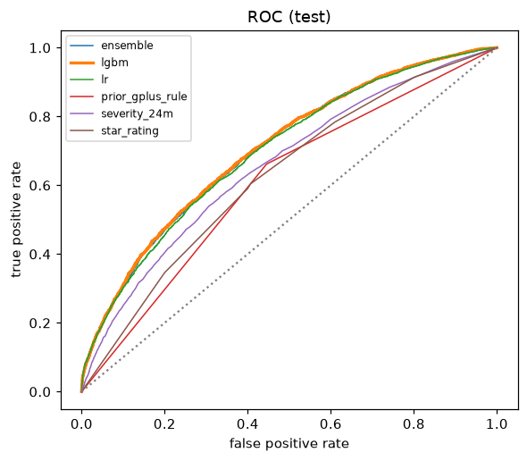 | 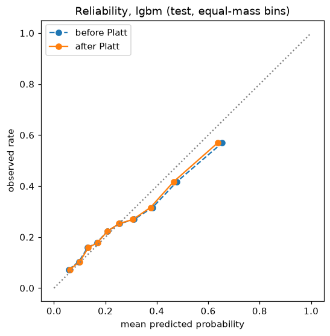 |
| 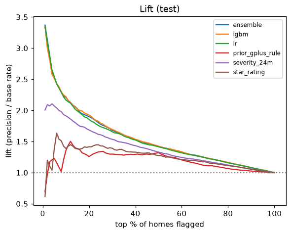 | 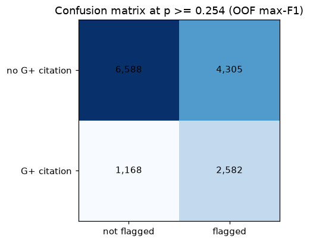 |

---

## 7. Bias detection and mitigation

### 7.1 Slices and metrics
CMS facility data has no person-level demographics, so the slices are facility attributes (`configs/bias_slices.yaml`):
state, CMS region, ownership group, bed band, chain status, in-hospital, CCRC, SFF status and star band. Per slice
value (`evaluation/slices.py`, Fairlearn `MetricFrame`): homes, events, mean predicted p, **O−E** (observed minus
expected rate, the calibration gap that matters to an insurer) with a facility-clustered CI, PR-AUC, and at the global
top 10 % the flag share, precision, recall, false-positive and false-negative rates. Written to `slices.csv`, the
model card and MLflow. Data-side bias (label rates, inspector effects) is analysed before any model exists:
[`bias/findings.md`](bias/findings.md).

### 7.2 The gate and the result
Gate G7 (§9.1) judges `bias.gate_slices` without the geographic ones: ownership group, bed band, chain status and
in-hospital (`state` joins with the Benjamini-Hochberg correction in Phase 2, ML-27), on values with at least 200 homes
and 50 events: (a) against the champion, no group's |O−E| grows by more than 0.03 or its PR-AUC
drops by more than 0.05; (b) no group's O−E CI lies entirely outside ±0.05. A failure holds the model and emails.

**Result (champion v1, test 2025-02):** 0 calibration failures. Among the reported non-geographic groups of 400+ homes,
the largest gaps are SFF candidates (−0.051, 433 homes, CI −0.096 to −0.007; reported, not gated), homes with 200+ beds (+0.044,
CI +0.014 to +0.073), homes under 50 beds (−0.031) and 1-star homes (−0.029); the model over-predicts overall by 1.5
points (mean p 0.271 vs 0.256), which explains most of the negative gaps. States differ most (Oregon −0.185, Hawaii
−0.176, South Dakota +0.168, Mississippi +0.162): reported, not gated (below).

**Result (reproduction run, lgbm):** 0 calibration failures: no gated group's O−E 95 % CI lies wholly
outside ±0.05. Among the reported non-geographic groups of 400+ homes, gated or not, the largest gaps are SFF candidates (−0.050,
433 homes, CI −0.094 to −0.006; SFF status is reported, not gated), homes under 50 beds (−0.045) and homes with 200+
beds (+0.040). Most of each group's gap is one overall shift: on 2025-02 the model over-predicts by
2.6 points (mean p 0.282 vs an observed 0.256; in-hospital = false, 14,182 of the 14,643 homes, is −0.026), as an
evaluation fit whose data ends 15 months before the test month can. So −0.045 for small homes is mostly that shift,
not a small-home problem.
Ranking is weaker for small homes (PR-AUC 0.28) and 4- and 5-star homes (0.33, 0.23), where events are rarer. States vary most (as the
data analysis found); they are reported, not gated, and per-state shrinkage is Phase 2.


*The champion's bias chart (`phase1-retrain-2/report/bias_slices.png`, drawn by `ml evaluate`): per slice value, O−E with
its 95 % CI against ±0.05 (red would mean G7(b) fails), PR-AUC against all homes, and the false-negative rate at the
top 10 %. Homes in brackets.*

### 7.3 Mitigation and its trade-off
Every `evaluate` refits the selected candidate fold by fold with **inverse-frequency sample weights on ownership
group** (clipped 0.2 to 5, fit on the window's own rows) and compares it with the unweighted model on OOF predictions,
never on test. Setting `bias.mitigation: reweight` makes `train` fit every member on those weights; it is a recipe
change, so it goes through the gates. Other remedies the guidelines name (re-sampling, per-group thresholds) are not
used: the score is a calibrated probability, and per-group thresholds would break calibration across groups.

| Variant (eval-window OOF, lgbm) | PR-AUC | Brier | ECE | largest gated \|O−E\| | miscalibrated groups |
|---|---|---|---|---|---|
| **champion v1** (production window, 163,066 rows): none (in use) | 0.511 | 0.1609 | 0.0050 | 0.016 | 0 |
| champion v1: reweight (ESS 72,158) | 0.505 | 0.1618 | 0.0055 | 0.022 | 0 |
| reproduction (162,276 rows): none | 0.523 | 0.1666 | 0.0050 | 0.018 | 0 |
| reproduction: reweight (ESS 71,987) | 0.517 | 0.1678 | 0.0044 | 0.013 | 0 |

**Decision (made at Checkpoint ML-A):** keep `none`. No group is miscalibrated, so there is nothing to fix. On the
production window reweighting costs 0.006 PR-AUC **and widens** the largest gap (0.016 to 0.022); on the reproduction
window it narrowed it slightly at the same cost. The trade-off is recomputed and printed in every model card, so the
decision is revisited every month.

---

## 8. Hyperparameter tuning

- **Method:** Optuna, TPE sampler (Bayesian optimisation), seed 42, 30 trials, 60-minute cap, one at a time.
- **Objective:** mean held-out PR-AUC of the ensemble over **3 facility-grouped folds of `eval_train`**, with early
  stopping (100 rounds) per fold; the final tree count is the median best iteration. The test month is never used.
- **Search space** (`configs/ml.yaml: tuning.space`, from PR #49's `boost_models.py`):

| Parameter | Range | Parameter | Range |
|---|---|---|---|
| learning_rate | 0.005 to 0.1, log | subsample | 0.5 to 1.0 |
| num_leaves | 8 to 128 | colsample_bytree | 0.3 to 1.0 |
| max_depth | 3 to 12 | reg_alpha | 0.001 to 10, log |
| min_child_samples | 20 to 1,000 | reg_lambda | 0.001 to 30, log |
| min_split_gain | 0 to 1 | cat_smooth | 1 to 100 |
| LR `C` | 0.03, 0.1, 0.3, 1.0 | | |

- **Result**, two runs on the production window:
  - `tune-phase1-1` (CLI, 120 features, 889 s): best CV PR-AUC **0.5112**; trials 0.509 to 0.511.
  - `p1-retune-1` (the DAG's `mode=retune`, 119 features, 11 min): best **0.5111** (trial 22); trials 0.5091 to 0.5111 (median 0.5104). Its best: learning rate 0.076, 112 leaves, depth 3, 146 trees, LR `C` 1.0.
- **Output and decision:** `tuning/tuning_proposal.yaml`, ready to paste into `ml.yaml`, but applied only through a
  reviewed PR (ML-19). The gain over the current parameters is within noise, so PR #49's parameters stay. In Phase 1 a
  re-tune runs only by hand (`mode=retune`); a drift flag emails a request for one.

---

## 9. Sensitivity analysis

### 9.1 Features (SHAP)
Contributions are exact: TreeSHAP for LightGBM, `w·(z − mean)` for LR, the weighted mean for the ensemble, scaled by
the Platt slope, so for every home base + Σ contributions = the calibrated log-odds (checked to 1e-14 by gate G2).


| | |
|---|---|
| 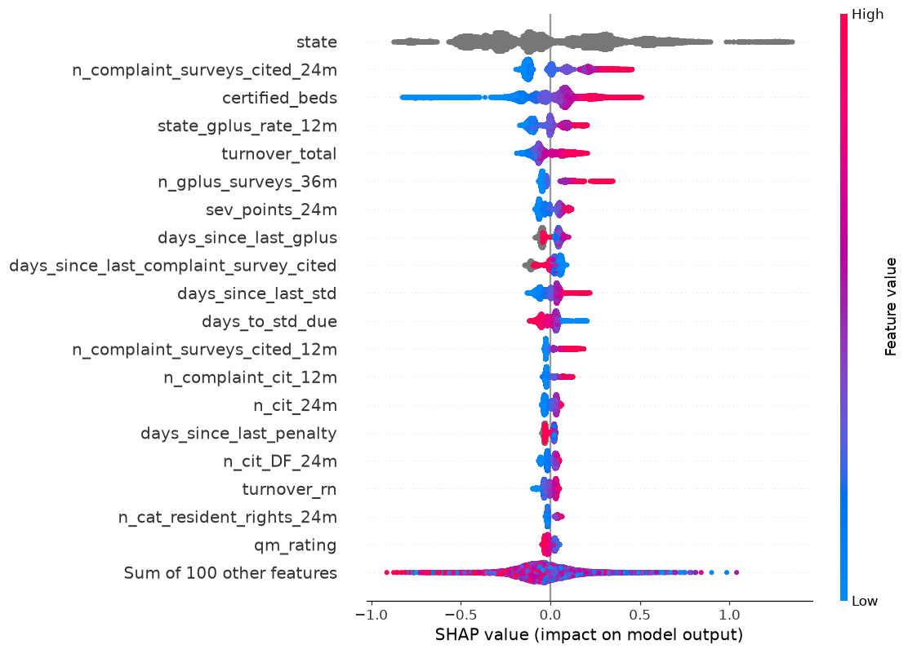 | 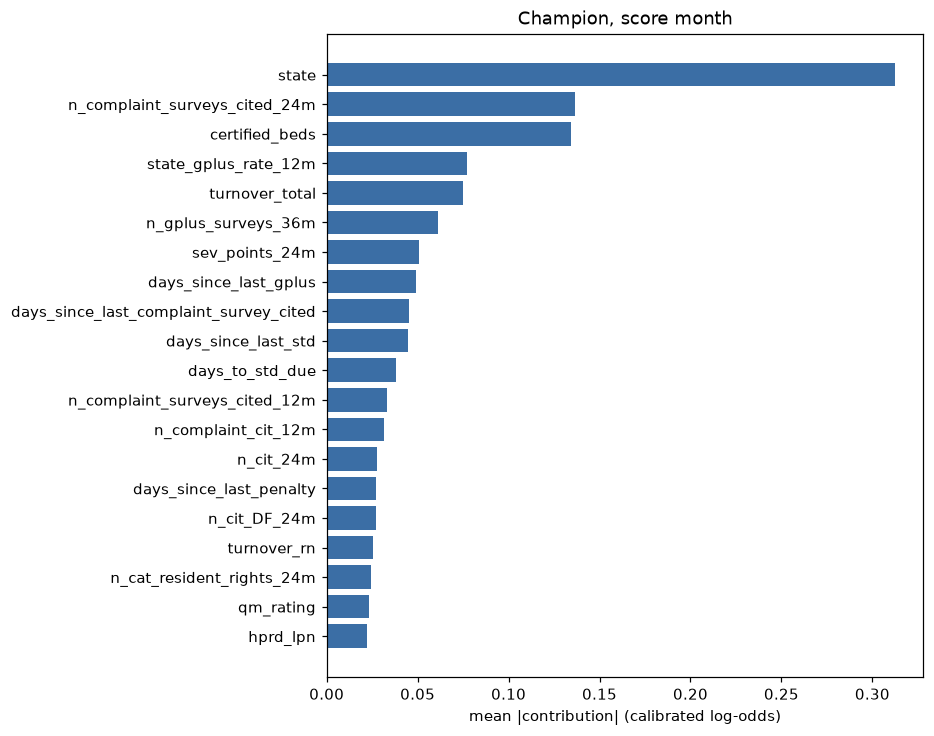 |

*Top: the champion's eval fit on the test month (from `evaluate`'s `shap_mean_abs.csv`). Bottom: the champion scoring
2026-10 (`phase1-promote-1/score/`, drawn by `ml score`). In the beeswarm, red is a high feature value: more complaint
surveys with citations, more beds, higher staff turnover and more past G+ surveys push the risk up; small homes push it
down.*

- **Location and history dominate:** the home's state and the state's recent G+ rate (inspection practice differs by
  state), size, and the home's own complaint and citation history (complaint surveys cited, citations, recent G+
  surveys, days since the last G+).
- **Staffing and quality add the rest:** turnover, hours per resident day, the QM rating and individual measures.
- **Per home:** `ml score` writes the top 5 risk-raising and top 3 risk-lowering features of every home, with the
  value and a plain-language label (`configs/reason_labels.yaml`), plus the full SHAP matrix and a beeswarm plot per
  month. `scripts/ml_checkpoint_reasons.py` prints the same reasons for any registered version (Checkpoint ML-A).

### 9.2 Hyperparameters
fANOVA importances:
- `p1-retune-1` (charts below): **`max_depth` 0.49**, `min_split_gain` 0.15, **LR `C` 0.14**, learning rate 0.09, the rest 0.04 or less.
- `tune-phase1-1`: LR `C` 0.41, `max_depth` 0.23, the rest 0.07 or less.

Both runs agree on what matters (tree depth and LR's regularisation) and on the best region: shallow trees (depth 3
to 4) and `C` = 1.0 (22 of 30 trials each). The ordering moves between runs because the whole spread is only 0.002
PR-AUC, so these importances describe a flat surface, not a strong lever.

| | |
|---|---|
|  | 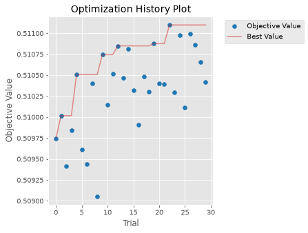 |

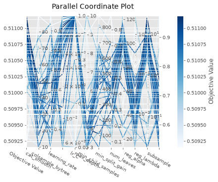

---

## 10. Experiment tracking and the model registry

- **MLflow 3** runs as a compose service (backend: Postgres database `mlflow`; artifacts proxied to
  `gs://precursor-intel-mlops-mlflow/`). Tasks log over HTTP; the UI is local only.
- **One MLflow run per task** (`train`, `evaluate`, `gate`, `tune`, `score`) in experiment `precursor_y_g12`. Every run
  is tagged with the ML run id, gold run, `V`, `V_L`, `dataset_version`, gold verified, git sha, image, `recipe_hash`,
  decision and mode, and logs:
  - `train`: every hyperparameter, Platt parameters, windows, feature count and hash, excluded features, OOF metrics,
    PSI, timings; the input dataset; one model per candidate (MLflow pyfunc); selection, windows and input manifest;
  - `evaluate`: every metric of section 6 per candidate and baseline, the mitigation trade-off, the plots;
  - `gate`: G1 to G7 (`gates.json`) and the model card;
  - `tune`: the trials table, the proposal, importances and the three plots.
- **Registry:** model `precursor_y_g12`; `ml gate` registers the refit package as a new version, tagged with its run, gold and recipe, and
  aliases it `@challenger` or `@champion`. Scoring and rollback load the package from the run folder after checking
  its sha256 against `train.json`; MLflow's copy is never unpickled.
- **Audit:** every decision, gate result, promotion and publish is a row in the Postgres table `ml_runs`.

---

## 11. Gates, promotion and rollback

All seven gates are deterministic code (`evaluation/gates.py`, values in `configs/ml.yaml: gates`). Comparisons with
the champion are paired on the same test rows: "worse" means beyond the tolerance and the bootstrap CI of the
difference excludes zero.

| Gate | Passes when |
|---|---|
| G1 Data | the input checks passed; gold verified or `allow_unverified` |
| G2 Sanity | no uncleared single-feature leakage flag; SHAP additive; the mean ROC-AUC of 10 models trained on shuffled labels is 0.44 to 0.56 |
| G3 Beats the rule | PR-AUC better than the prior-G+ rule (paired CI above 0) |
| G4 Calibration | test ECE ≤ 0.05 and calibration slope in 0.7 to 1.3 |
| G5 Not worse than the champion | PR-AUC not worse by more than 0.01, Brier not worse by more than 0.005 (skipped without a champion) |
| G6 Refit sanity | the refit's OOF lift ≥ 0.85 × the eval fit's; its mean score within ±0.05 of the recent observed rate; Spearman ≥ 0.9 with the eval fit on the score month |
| G7 Bias | section 7.2 |

- **Promotion:** all gates pass and a champion exists → the new version becomes `@champion`; otherwise it is
  registered as `@challenger`, the champion keeps scoring and an email says which gate held.
- **The first version** is never promoted automatically (`gates.first_run: challenger`): a person reads the model
  card, `gates.json`, the slice table and 20 homes' reasons (**Checkpoint ML-A**) and promotes it with
  `mode=promote`, `version` and `reason`.
- **Rollback:** the same `mode=promote` with an earlier version. Only a version that passed G1 and G2 can be promoted;
  every promotion and rollback is an `ml_runs` row, and `score` refuses a champion whose alias moved outside it.

**What the stack showed** (registry `precursor_y_g12`, 2026-11-17 and 18):

| Version | Run | Gates | Outcome |
|---|---|---|---|
| v1 | `phase1-retrain-2` | G1-G4, G6, G7 pass; G5 skipped (no champion) | `@challenger` (first version) → **Checkpoint ML-A** → `@champion` (`phase1-promote-1`) |
| v2 | `p1-retrain-2` | **all seven pass**, incl. G5 "not worse than the champion" and G7(a) "12 slice values compared" | **promoted automatically** (v1 → v2), scored and published in the same run |
| v3 | `p1-bad-candidate-1` (its 5 strongest features excluded on purpose) | **G5 fail**: PR-AUC −0.021 vs the champion (paired CI −0.029 to −0.013); also G2 (see section 15) | **held** as `@challenger`; the champion was unchanged |
| v1 | `p1-rollback-v1` (`mode=promote`, version 1) | (G1, G2 checked) | **rollback** v2 → v1, audited (`ml_runs` action `rollback`), scored with v1 |

---

## 12. CI/CD, notifications and containers

- **CI on every pull request** (`.github/workflows/ci.yml`): ruff and the offline test suite (1,500+ tests, with a
  leakage suite) on Python 3.11 and 3.12, and `dvc repro` of the **`toy_ml` stage: the whole chain**, prepare →
  train → evaluate → gate → register (a SQLite MLflow store) → score → publish, **on a synthetic gold**
  (`tests/ml/make_ml_gold.py`). A failed step or a gate that holds the model (validation or bias) fails the check, and
  the `ci-ok` check is required to merge. The images job builds the three images, runs the DAG tests in the Airflow
  image and starts MLflow in the compose bundle.
- **CD:** `.github/workflows/cd.yml` pushes the images to Artifact Registry on every merge to `dev` or `main` that changes code, configs or images; `deploy.yml` points the VM
  at a release (the VM runs the data pipeline today; the ML DAG moves there in Phase 2).
- **Notifications** (`dags/cms_nh_ml.py: notify`, `precursorintelligence.alerts`): every finished run emails its
  summary (decision, gate outcome, champion version, test PR-AUC and Brier with CIs, drift flags, a re-tune request);
  a failed run emails the failure (`on_dag_failure`). On the stack, every DAG run from `phase1-retrain-2` on emailed the team (the alert settings were added after the
  first run; the CLI run sends none), e.g.
  `[cms_nh_ml] RETRAIN 2026-10` and `[cms_nh_ml] PROMOTE 2026-10: 3 flag(s); re-tune requested` (that re-tune request
  was a false alarm: section 15).
- **Containers:** every step runs in `precursor-pipeline` (built from `uv.lock`, with the `ml` and `bias` extras); the
  same image runs in CI, in Airflow and by hand. MLflow has its own image (`docker/mlflow.Dockerfile`).
- **Reproducibility:** fits are seeded and deterministic; a run is keyed on gold's `dataset_version` and the
  `recipe_hash` (code + `ml.yaml` + feature list), and its pinned input stays in its run folder.

---

## 13. How to run it

**Offline, on synthetic data (no credentials, a few minutes):** the same chain CI runs.
```bash
uv sync --all-extras
uv run dvc repro --force --single-item toy_ml      # outputs in data/toy_ml/, summary in metrics/toy_ml.json
```

**On the real gold, step by step** (a GCS-rooted store at `ml-dev/`; MLflow is optional up to `evaluate`, but `gate`'s
registration and the reasons script need it):
```bash
export PI_BUCKET_URI=gs://precursor-intel-mlops-data/ml-dev PI_DATABASE_URL=sqlite:///data/ops/ml-local.db
export MLFLOW_TRACKING_URI=http://localhost:5000      # needed from gate on; unset skips tracking up to evaluate
for step in prepare train evaluate gate; do
  uv run precursor-pipeline ml $step --env prod --run-id my-run-1 || break
done
uv run python scripts/ml_checkpoint_reasons.py --run-id my-run-1 --version 1 --out reasons.csv
```

**In Airflow** (the laptop stack, `docs/runbooks/airflow-local.md`):
```bash
docker compose exec airflow-scheduler airflow dags unpause cms_nh_ml
docker compose exec airflow-scheduler airflow dags trigger cms_nh_ml --conf '{"mode": "retrain"}'
docker compose exec airflow-scheduler airflow dags trigger cms_nh_ml \
  --conf '{"mode": "promote", "version": 1, "reason": "ML-A approved by <name> after reading model_card.md"}'
```
`retrain` → train, evaluate and gate (the first version becomes `@challenger`); `promote` → the champion scores,
publishes and is monitored. A rollback is the same `promote` with an earlier version; `retune` runs the tuning alone.

---

## 14. The runs behind the numbers

All on the laptop integration stack `ml_dev` (Airflow 3 + MLflow + Postgres in Docker Compose), reading the gold run
`20261112T020010Z-543cdc` (`dataset_version` `3f9bac9367ae18ec`). Each task ran in a container capped at 7 GB; the
largest step peaked at 3.1 GB.

**The acceptance runs** (8 DAG runs of `cms_nh_ml` and one CLI run, pipeline image from `dev` at `5153046`, 119 features,
2026-11-17 and 18). Together they
are spec §17.2's acceptance list:

| Run | Mode | Result |
|---|---|---|
| `phase1-retrain-1` | `retrain` | failed at `gate`: a real MLflow server refused the registration of a logged model without its id; fixed in PR #72 (the tests and CI use a SQLite store, which accepts it) |
| `phase1-retrain-2` | `retrain` | decide → prepare → train → evaluate → gate in 10 minutes; v1 `@challenger`; summary email |
| `phase1-promote-1` | `promote` v1 (Checkpoint ML-A) | v1 `@champion`; 14,686 homes scored for 2026-10 (scores, reasons, SHAP, 612 chains); `status/latest.json`; email |
| `p1-auto-1` | `auto` | **SKIP**: "nothing new: trained for this gold and recipe, and its scores are published" |
| `p1-score-only-1` | `score_only` | the same partition rewritten with **identical scores** (all four tables; only `ml_run_id` and `scored_at` differ) |
| `p1-retune-1` | `retune` | `tune` alone (section 8); nothing trained, gated or promoted |
| `p1-retrain-2` | `retrain` | v2 through all seven gates, **promoted automatically** (section 11) |
| `p1-bad-candidate-1` | CLI, an `ml.yaml` copy without the 5 strongest features | v3 **held** on G5 (section 11) |
| `p1-rollback-v1` | `promote` v1 | **rollback** v2 → v1 (section 11) |

**The earlier CLI runs** (pipeline image from `dev` at `a7cbf98`, 2026-11-16):

| Run (`ml/runs/<id>/`) | Config | Steps | Time, peak memory | MLflow |
|---|---|---|---|---|
| `repro-purge-1` | `ml.yaml` with `eval_gap: purge` (PR #49's setting), 120 features | prepare, train, evaluate (no gate: nothing registered) | 175 s / 3.0 GB, 390 s / 2.3 GB, 160 s / 2.0 GB | experiment `precursor_y_g12_reproduction`; train `3497311c`, evaluate `c5fb373a` |
| `tune-phase1-1` | `ml.yaml` (production window) | prepare, tune | 154 s / 3.1 GB, 889 s / 2.3 GB | experiment `precursor_y_g12`; tune `9fce913e` |

- The charts in `img/ml/` come from the DAG runs: the evaluation plots and the bias chart from `phase1-retrain-2/report/`,
  the champion's SHAP charts from `phase1-promote-1/score/`, the tuning plots from `p1-retune-1/tuning/`;
  `shap_top20.png` is drawn from `phase1-retrain-2`'s `shap_mean_abs.csv` with the pipeline's own plotting code.

### 14.1 Screenshots from the stack

Taken on the `ml_dev` stack on 2026-11-18 (MLflow at `127.0.0.1:5082`, Airflow at `127.0.0.1:8082`). Email senders and
recipients are redacted. Click a screenshot for the full size.

<table>
<tr>
<td width="50%"><a href="img/ml/screens/mlflow-experiment-runs.png">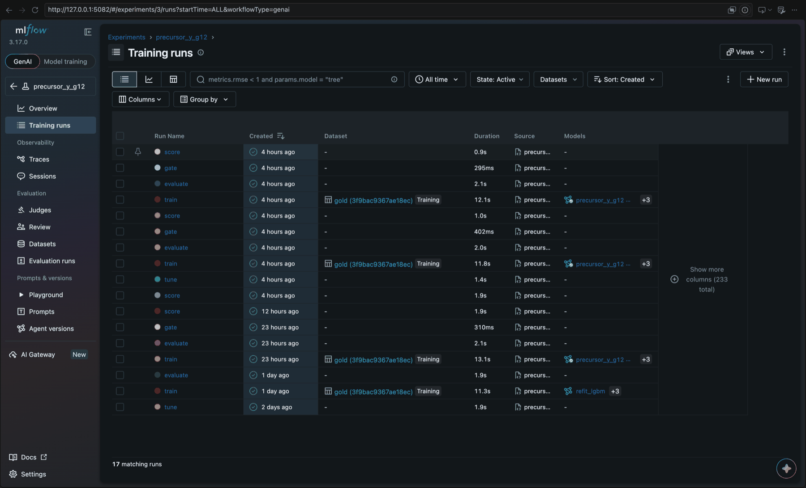precursor_y_g12</code>, one run per task (train, evaluate, gate, score, tune), the gold dataset logged as input" width="420"></a><br><sub>MLflow: experiment <code>precursor_y_g12</code>, one run per task (train, evaluate, gate, score, tune), the gold dataset logged as input</sub></td>
<td width="50%"><a href="img/ml/screens/mlflow-train-run.png">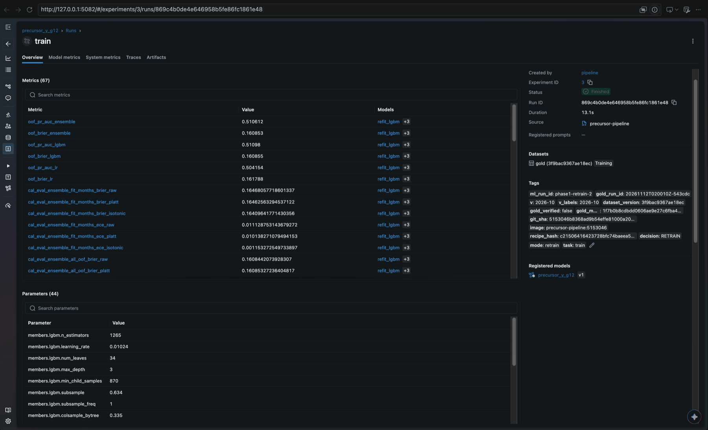train</code> run: 67 metrics (OOF PR-AUC and Brier per candidate, calibration diagnostics), 44 parameters, the provenance tags, registered as v1" width="420"></a><br><sub>MLflow: v1's <code>train</code> run: 67 metrics (OOF PR-AUC and Brier per candidate, calibration diagnostics), 44 parameters, the provenance tags, registered as v1</sub></td>
</tr>
<tr>
<td width="50%"><a href="img/ml/screens/mlflow-evaluate-artifacts.png">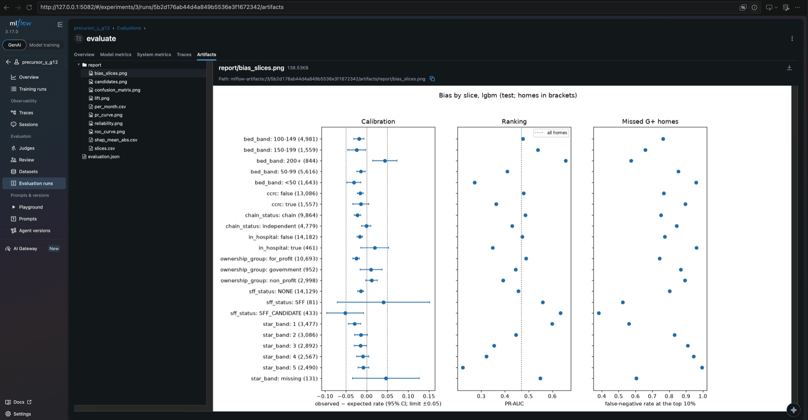evaluate</code> run's artifacts (the plots, <code>slices.csv</code>, <code>evaluation.json</code>), the bias chart open" width="420"></a><br><sub>MLflow: the <code>evaluate</code> run's artifacts (the plots, <code>slices.csv</code>, <code>evaluation.json</code>), the bias chart open</sub></td>
<td width="50%"><a href="img/ml/screens/mlflow-gate-model-card.png">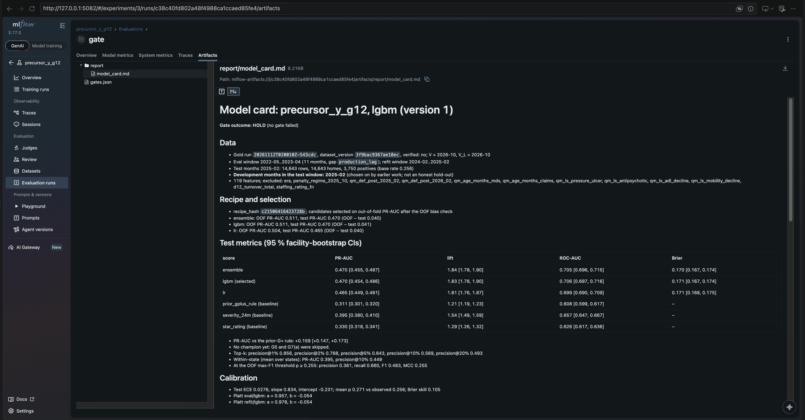</a><br><sub>MLflow: the <code>gate</code> run's model card for v1 (data, recipe and selection, test metrics with CIs, calibration). "Gate outcome: HOLD" because it is the first version: it waits as <code>@challenger</code> for Checkpoint ML-A</sub></td>
</tr>
<tr>
<td width="50%"><a href="img/ml/screens/mlflow-registry.png">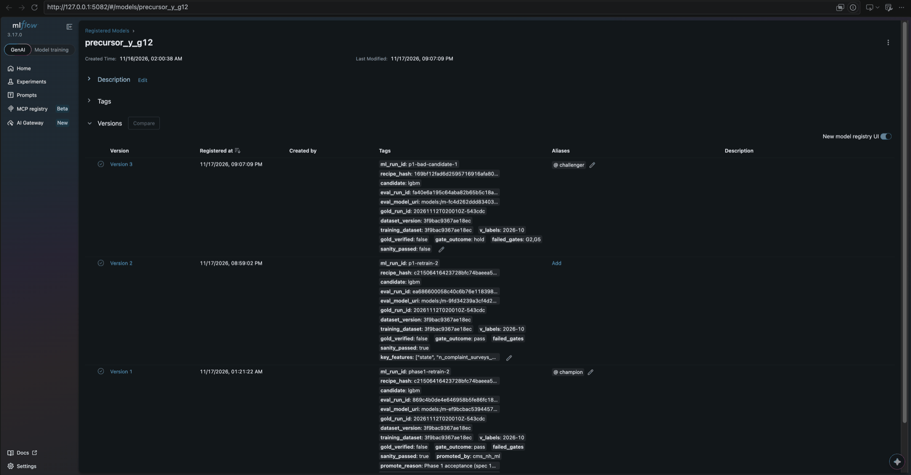@champion</code> (after the rollback), v2 (promoted automatically, then rolled back), v3 <code>@challenger</code> (held: failed G2, G5)" width="420"></a><br><sub>MLflow registry: v1 <code>@champion</code> (after the rollback), v2 (promoted automatically, then rolled back), v3 <code>@challenger</code> (held: failed G2, G5)</sub></td>
<td width="50%"><a href="img/ml/screens/mlflow-tune-run.png">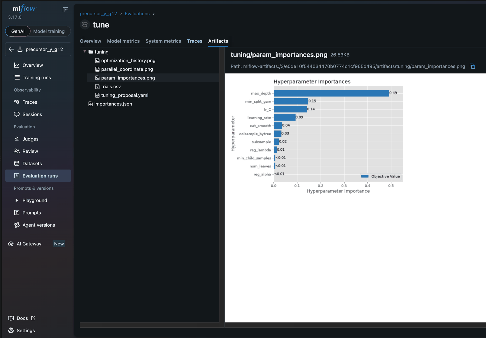tune</code> run (<code>mode=retune</code>): the proposal, the trials and the sensitivity plots" width="420"></a><br><sub>MLflow: the DAG's <code>tune</code> run (<code>mode=retune</code>): the proposal, the trials and the sensitivity plots</sub></td>
</tr>
<tr>
<td width="50%"><a href="img/ml/screens/airflow-grid.png">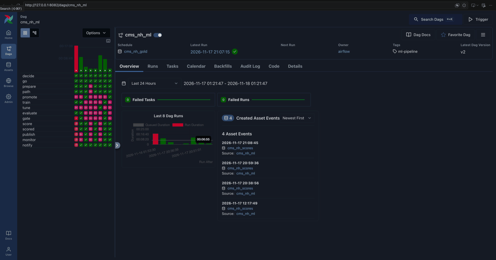cms_nh_ml</code> run; the red <code>gate</code> is <code>phase1-retrain-1</code> (fixed in PR #72); pink is a branch not taken" width="420"></a><br><sub>Airflow: every <code>cms_nh_ml</code> run; the red <code>gate</code> is <code>phase1-retrain-1</code> (fixed in PR #72); pink is a branch not taken</sub></td>
<td width="50%"><a href="img/ml/screens/airflow-graph-promote.png">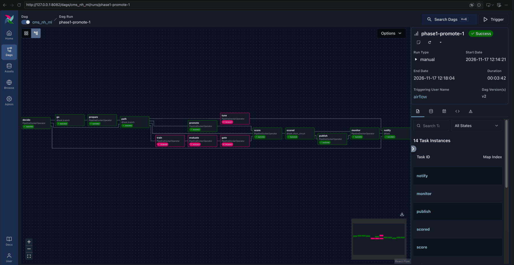phase1-promote-1</code> (Checkpoint ML-A): decide → prepare → promote → score → publish → monitor → notify; train, evaluate, gate and tune skipped" width="420"></a><br><sub>Airflow: <code>phase1-promote-1</code> (Checkpoint ML-A): decide → prepare → promote → score → publish → monitor → notify; train, evaluate, gate and tune skipped</sub></td>
</tr>
<tr>
<td width="50%"><a href="img/ml/screens/airflow-graph-auto-promotion.png">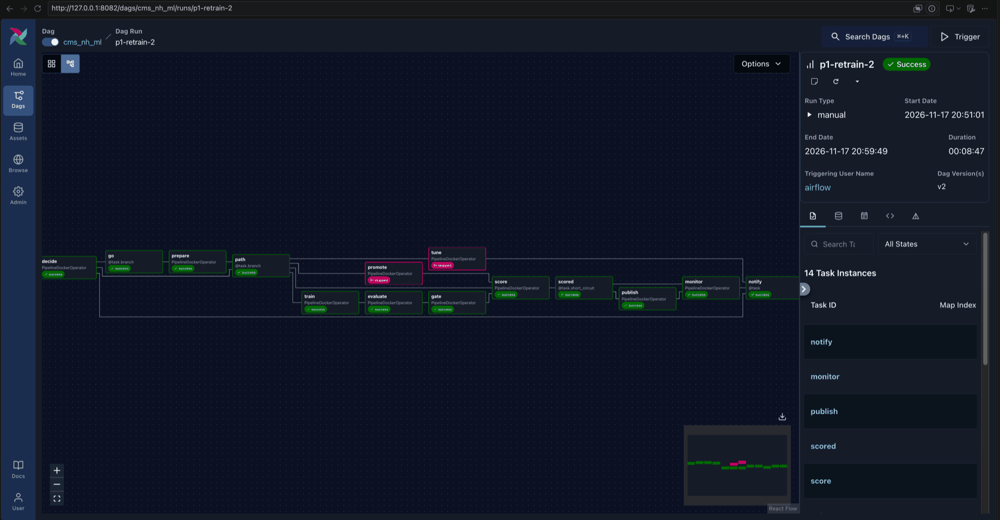p1-retrain-2</code>: train → evaluate → gate (all seven gates passed, promoted automatically) → score → publish → monitor → notify" width="420"></a><br><sub>Airflow: <code>p1-retrain-2</code>: train → evaluate → gate (all seven gates passed, promoted automatically) → score → publish → monitor → notify</sub></td>
<td width="50%"><a href="img/ml/screens/email-auto-promotion.png">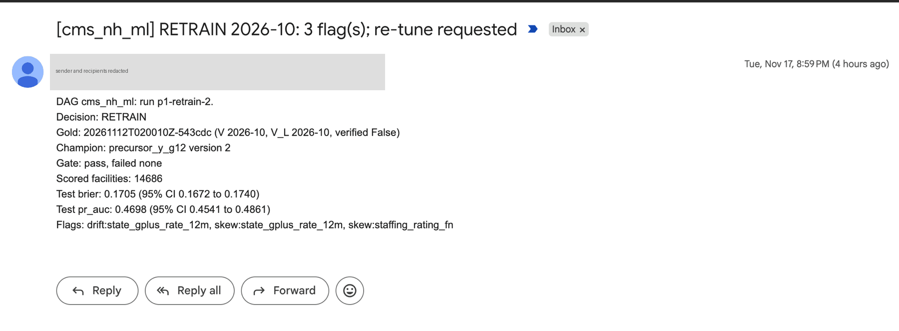p1-retrain-2</code>: the new champion (v2), gate pass, the test metrics with CIs, the flags (the drift flag is the false alarm of #73)" width="420"></a><br><sub>Email from <code>p1-retrain-2</code>: the new champion (v2), gate pass, the test metrics with CIs, the flags (the drift flag is the false alarm of #73)</sub></td>
</tr>
<tr>
<td width="50%"><a href="img/ml/screens/email-first-run-challenger.png">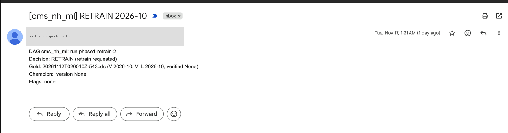phase1-retrain-2</code> (the first version): no gate outcome or metrics, because <code>monitor</code> was skipped without scores (#73)" width="420"></a><br><sub>Email from <code>phase1-retrain-2</code> (the first version): no gate outcome or metrics, because <code>monitor</code> was skipped without scores (#73)</sub></td>
<td width="50%"></td>
</tr>
</table>

---

## 15. Known limitations and Phase 2

- **Labels lag 20 months**, so the newest test month is 2025-02 at `V_L` = 2026-10, and it is a development month.
  Checkpoint ML-A (2026-11-17) read 2025-02, the only test month so far (spec §17.3 asks for non-development months
  *where available*); it is re-read on 2025-03 when the next CMS release (due 2026-12-02) brings it in. G5 on v2 and v3 was also
  decided on 2025-02. The threshold review (spec O2) also waits for 2025-03.
- **Unverified gold is allowed** (`allow_unverified: true`, tagged on every run) until the data spec's §11
  verification gate exists.
- **Phase 2:** MLflow and the ML DAG on the GCP VM (the registry starts fresh there); BigQuery publish; the tuned
  challenger and an automatic re-tune; the performance trend and score drift in monitoring; per-state empirical-Bayes
  shrinkage; MLflow authentication (the UI is local only today); the API, the four agents and the dashboard.
- **States differ most** in calibration; they are reported, not gated, until per-state shrinkage lands.
- **Issues found on the stack**, each assigned to its work package's owner:
  - **#73** (nishanth3112): `monitor` was skipped on a run without scores (the first version), so no status file was written, and PSI on a feature with one value per state (`state_gplus_rate_12m`) read 0.96 for a 0.003 change, which emailed a **false re-tune request** after the promotion. Both fixed (this PR): `monitor` no longer hangs off the `scored` short-circuit, and group-level features get equal-width PSI bins (0.072 on the same month). Still open for Phase 2: CI's `gs://` MLflow artifacts and tracking that is silently off on the VM.
  - **#74** (tanoj22), fixed: G2's single shuffled-label model was noisy (0.4835, 0.4987 and 0.5253 on real data; the last failed the [0.48, 0.52] band, so v3 failed G2 too), and G2 now judges the mean of 10 shuffles (#79). Promote verifies the target's packages (#77).
  - **#75** (RiyaNTaori): `gold_run_id` on every score table, plot errors that no longer stop `score`, and the chain's P(≥1 event) are fixed (#80). The registered versions' packages now outlive their run folders: `gate` copies them to the MLflow bucket's `packages/`, and `score`, `evaluate` and `promote` load only from there (this PR).
  - **#76** (Aakash-2904), fixed (#78): `recipe_hash` covers the bias config, and tune's MLflow run is tagged correctly.
