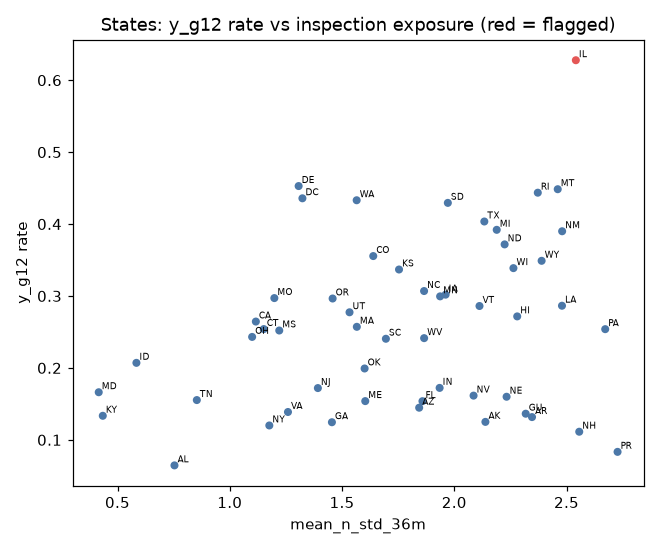
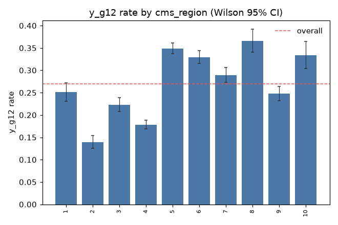
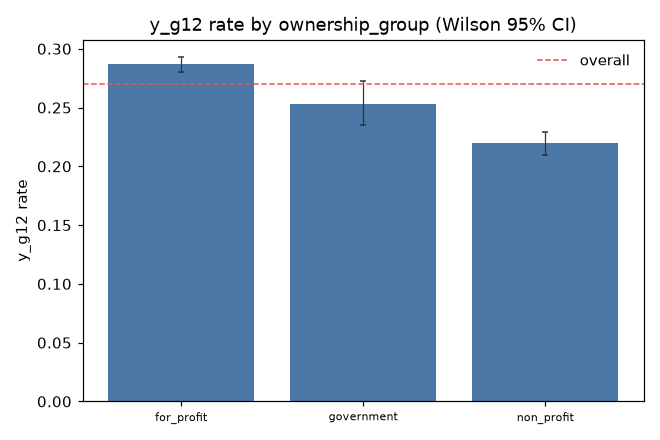
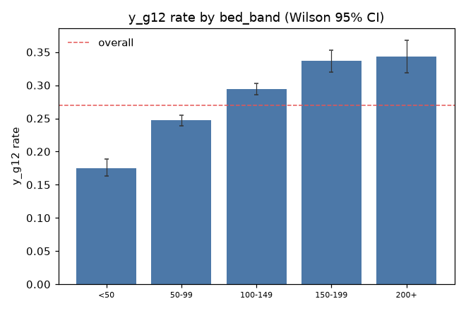

# Data bias findings: real gold run

What the data-level bias check found on our gold dataset, the mitigation we propose, and the trade-offs. How
the check works is in [`README.md`](README.md); every number here comes from one run and can be regenerated
with `uv run precursor-pipeline bias-report` (the full outputs are not committed: data stays out of git).

**Run.** Gold V = 2026-08 (run `20261027T183821Z-f2ea91`, 39 monthly partitions, read through the
sha256-checked `gold/_current.json`), t = 2023-01 to 2026-08, 578,975 home-months from 15,274 homes,
scope `all_labeled`. Two runs in a row give byte-identical outputs.

| label | labeled rows used | positive | immature (excluded) | censored (excluded) |
|---|---|---|---|---|
| `y_g12` | 323,815 | 87,442 (27.0%) | 250,392 | 4,768 |
| `y_g6` | 397,928 | 61,147 (15.4%) | 176,549 | 4,498 |
| `y_pen12` | 279,576 | 76,332 (27.3%) | 294,830 | 4,569 |

192 slice values (9 single attributes, 5 two-way crossings), 525 label × slice tests.

## What "bias" means here

Our product is a calibrated probability of a serious (G–L) citation, used by insurers to price cover. A kind of
home can be harmed in two ways: it is scored too high (it pays more or is refused cover), or its score is
less accurate. A difference in label rate between slices is **not** bias by itself; some kinds of homes really
are riskier. The check's job is to find the differences and separate real risk from flaws in how the data was
produced (who inspects, what is missing, who drops out). There are no person-level demographics in CMS
facility data: the slices are facility attributes and state inspection practice, not protected classes.

## Findings

**Inference is by home.** A home is labeled in many months and its 12-month windows overlap, so its labels are
strongly correlated: the median effective sample size is 12% of the row count (design effect ≈ 8.5). All tests
and intervals use home-clustered variances. With states shuffled between homes (no real state effect), the test
finds 0 significant states in 20 of 20 runs; on the real data it finds 36.

### 1. State is the strongest slice, and partly a measurement effect

120 (label, slice) pairs are problematic (BH-adjusted p < 0.05, |Cohen's h| ≥ 0.2, not small, not a risk tier);
almost all are states or state crossings.

| state | homes | `y_g12` rate | rest | h |
|---|---|---|---|---|
| IL | 687 | 0.628 | 0.253 | +0.78 |
| DE | 44 | 0.453 | 0.269 | +0.38 |
| MT | 61 | 0.448 | 0.269 | +0.38 |
| RI | 74 | 0.444 | 0.269 | +0.37 |
| AL | 224 | 0.065 | 0.273 | −0.59 |
| NH | 74 | 0.111 | 0.271 | −0.41 |
| NY | 603 | 0.120 | 0.276 | −0.40 |

Labels come from state survey agencies, so a state's rate mixes how risky its homes are with how often and how
severely it inspects. Across states, the label rate correlates with inspection frequency (`n_std_36m`,
ρ = 0.40) and with how severely the state cites (its G+ share of all citations, ρ = 0.37). Its correlation with
the state's own past G+ rate (ρ = 0.87) is persistence, not evidence of rater bias. **IL** is flagged on all
three labels (label rate and inspection exposure both above the 90th percentile of states), **MT** on `y_g6`.
We cannot fully separate inspection practice from real risk with this data.

### 2. Ownership, size and setting differ, but by less than the threshold

| slice | value | homes | `y_g12` rate (95% CI) |
|---|---|---|---|
| ownership | for-profit | 11,251 | 0.287 (0.281–0.293) |
| ownership | government | 1,254 | 0.253 (0.235–0.272) |
| ownership | non-profit | 3,628 | 0.219 (0.210–0.230) |
| beds | < 50 | 1,816 | 0.175 (0.163–0.188) |
| setting | in a hospital | 630 | 0.163 (0.142–0.185) |
| chain | chain (from 2023-06) | 10,384 | 0.288 (0.281–0.295) |
| chain | independent (from 2023-06) | 6,202 | 0.244 (0.235–0.253) |

These are real differences between kinds of homes (the four-fifths ratio flags some, e.g. for-profit 1.26 and
non-profit 0.77), but none reaches |h| ≥ 0.2 on its own. They are risk differences to keep an eye on in the
model's per-slice metrics, not something to remove from the data. Chain status before 2023-06 is `missing`:
CMS did not publish the column then.

### 3. Risk tiers behave as expected

SFF status and star rating are built from past inspections, so higher rates there are expected: `y_g12` is 0.46 for SFF homes and 0.48 for SFF
candidates against 0.26 for the rest, and falls steadily from 0.40 at 1 star to 0.14 at 5 stars. They are reported in their own section and never counted as problematic. Star
bands are also shown per rating era, since CMS changed the method in 2025-07.

### 4. Who drops out: censoring

1.5% of matured `y_g12` rows are censored (the home closed before its window ended). It is much higher for
homes with no star rating (8.5%), SFF homes (7.8%), homes in a hospital (6.1%) and homes under 50 beds (5.4%):
68 slice values are flagged. Rates for those slices describe the homes that survived, so they likely
understate the risk of the group as a whole.

### 5. Missing data

130 slice × feature gaps of 10 points or more. The largest: star ratings and quality-measure ratings are missing
for every SFF home and every home with no star rating (CMS does not rate them), and staff turnover data is missing
more often for homes under 50 beds (31% vs 18%) and homes in a hospital (22% vs 11%). The model knows less about these homes, so its scores for them will be
less reliable (a quality-of-service risk).

### 6. Drift within slices

1,490 slice × feature pairs drift between train and test beyond what random same-size samples of all homes show
(so beyond ordinary time drift and sample noise). Most are states (873) and regions (287): states change their
own rules and staffing over time. This is a monitoring signal for the ML phase rather than a data fix.

## Proposed mitigation (needs team sign-off)

| finding | decision | why |
|---|---|---|
| State and region effects (105 pairs), IL / MT rater flags | **state-relative features** and **within-state evaluation** | inspection practice differs by state; comparing a home with its own state removes most of the measurement part |
| Ownership differences | **re-weight** on ownership (`sample_weights.parquet`, inverse frequency, train rows only) | keeps the smaller groups from being drowned out in training |
| 6 small slices with large ratios (AK, DC, GU, PR and two crossings) | **merge** or report without ranking | too few homes for a stable rate |
| Censoring, missingness | **document**, check per-slice model metrics | the gap is in what CMS publishes, not something the data step can fix |
| Within-slice drift | **monitor** in the ML phase | it is drift over time, not a data error |

The weights are fit on training rows only and written as a separate file; gold is never changed. With the
default clip [0.2, 5.0] the effective sample size is 40,153 of 90,419 weighted rows: for-profit 0.48,
non-profit 1.52, government at the 5.0 clip.

## Trade-offs

- **Re-weighting vs calibration.** We sell calibrated probabilities. Re-weighting changes the training
  distribution, so a weighted model must be re-calibrated on unweighted data, and `balance_label_rate`
  (Kamiran–Calders) deliberately breaks calibration by equalising rates. Whether weights are used by default is
  open in #27.
- **Precision vs sample size.** Weights shrink the effective sample size by more than half; the clip limits
  that but leaves government homes short of an equal share.
- **State effects: risk or measurement.** Removing state differences entirely would hide real risk; keeping them
  would pass inspection practice into prices. State-relative features are the middle path, and the choice is a
  team decision (#27).
- **Strict tests vs sensitivity.** Home-level inference and the size-matched skew baseline remove false alarms
  but need more data to call a slice different; small slices are reported, never ranked.

## Limitations

- Data level only: no model has been trained. Per-slice model metrics (precision at the top 5%, recall,
  PR-AUC, calibration) come in the ML phase with the same slice definitions.
- Fisher's exact test for tiny cells is on rows, so it ignores clustering; those slices are never problematic.
- One dataset vintage (V = 2026-08) and one set of splits.
