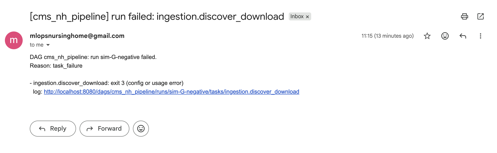
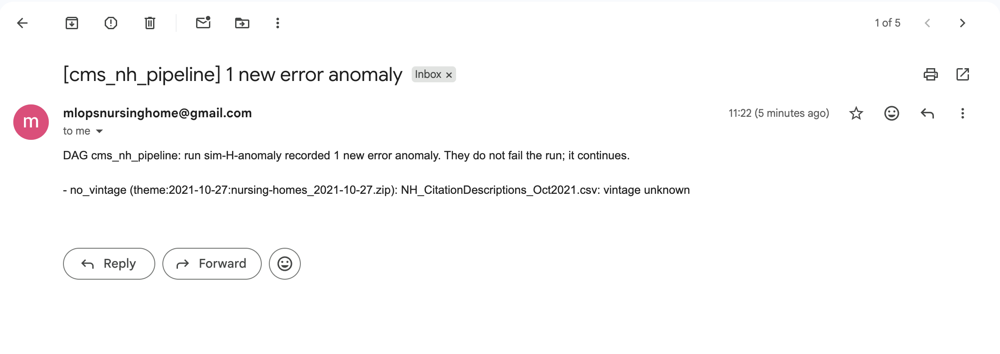

# Runbook: the data pipeline in Airflow (laptop and GCP VM)

How it works (DAG, tasks, lock, exit codes, metadata DB schema): [`../AIRFLOW_PIPELINE.md`](../AIRFLOW_PIPELINE.md). This page is the how-to.

One DAG, `cms_nh_pipeline` (spec §15), runs the implemented nodes **ingestion → bronze → silver → gold**. Every task is one CLI command in a `precursor-pipeline` container. The same compose file, images and DAG run on a laptop and on the VM; only `docker/airflow-local/.env` differs.

```
docker compose (docker/airflow-local/)
  postgres:16         databases airflow + precursor_meta (named volume)
  airflow-*           precursor-airflow image: api-server, scheduler (LocalExecutor), dag-processor, triggerer
  docker-proxy        the only Docker API access (containers + images), on an internal network only the
                      scheduler joins
  task containers     own network: Postgres + internet egress only (not Airflow, not the Docker API)
DAG task → PipelineDockerOperator → precursor-pipeline container on the compose network
  laptop: --env dev,  host folder bind-mounted at /app/data (the "bucket")
  VM:     --env prod, gs://precursor-intel-mlops-data via the VM's service account (no mount)
```

## 1. Build the images (from the repo root)
```bash
docker build -f docker/pipeline.Dockerfile --build-arg PI_GIT_SHA=$(git rev-parse HEAD) -t precursor-pipeline:latest .   # full SHA: gold's manifest records it
docker build -f docker/airflow.Dockerfile -t precursor-airflow:latest .
```
Rebuild `precursor-pipeline` after any change to `src/` or `configs/`; a task runs whatever the image holds. The DAGs are mounted, so a DAG edit needs no rebuild.

## 2. Configure and start
```bash
cd docker/airflow-local
cp .env.example .env && chmod 600 .env   # set the 4 secrets (required; commands in the file), PI_HOST_DATA_DIR, PI_DAG_SCHEDULE
mkdir -p "$PI_HOST_DATA_DIR"
docker compose up -d --wait --pull never     # --pull never: the two precursor-* images are local builds
```
- **UI:** http://localhost:8080. User `admin`; the password is in the `airflow-config` volume:
  `docker compose exec airflow-apiserver cat /opt/airflow/config/simple_auth_manager_passwords.json`
- **Laptop:** set `PI_DAG_SCHEDULE=` (empty), so runs are manual only. With `@daily`, unpausing starts a run over **every** in-scope zip (about 2.5 GB).
- **The DAG starts paused.** Unpause it: `docker compose exec airflow-scheduler airflow dags unpause cms_nh_pipeline`.

### 2.1 Against the GCS bucket from a laptop
Each layer gets its own folder in one bucket: `gs://precursor-intel-mlops-data/{landing,bronze,silver,gold,reports,metadata}/…`. `quarantine/` appears only if a download failed. Each folder appears on its first write.

**Don't create folders by hand in the console:** a zero-byte placeholder inside a table folder breaks the reads.

1. **Log in once** (each command opens the browser):
   ```bash
   gcloud auth login
   gcloud config set project precursor-intel-mlops
   gcloud auth application-default login     # writes ~/.config/gcloud/application_default_credentials.json
   gcloud auth application-default set-quota-project precursor-intel-mlops
   gcloud storage ls gs://precursor-intel-mlops-data/      # access check
   ```
2. **In `.env`:**
   - `PI_PIPELINE_ENV=prod`
   - `PI_HOST_DATA_DIR=` (empty)
   - `PI_BUCKET_URI=` (empty, so the bucket root), or `gs://precursor-intel-mlops-data/trial-<date>` for a trial
   - `PI_GCP_CREDENTIALS_FILE=<absolute path of that ADC file>`

   Every task container then gets the file mounted read-only (`GOOGLE_APPLICATION_CREDENTIALS`). On the VM, leave it empty: the VM's own identity is used.

   > **Warning:** this puts **your personal gcloud login** into containers that download and open untrusted zips from the internet.
   > - It carries a refresh token with all your project permissions, far more than the VM's `sa-pipeline`.
   > - Use it only for short laptop trials.
   > - Afterwards, set `PI_GCP_CREDENTIALS_FILE=` (empty) again and run `gcloud auth application-default revoke`.
   >
   > The planned replacement is impersonating `sa-pipeline`. It needs `roles/iam.serviceAccountTokenCreator` on it in Terraform; then `gcloud auth application-default login --impersonate-service-account=sa-pipeline@precursor-intel-mlops.iam.gserviceaccount.com` limits the mounted login to the bucket.
3. **Start the stack and trigger runs as in §2–§3.** The metadata database is the compose Postgres. A fresh database pointed at a bucket that already holds data adopts the zips there after validating them, then rebuilds bronze and silver.
4. **Delete a trial prefix.** Versioning keeps every old version unless you delete them all:
   `gcloud storage rm -r --all-versions gs://precursor-intel-mlops-data/trial-<date>/`

**Without Airflow**, the CLI on the host uses your login directly:
`PI_DATABASE_URL=sqlite:///<file> PI_BUCKET_URI=gs://… uv run precursor-ingest step1 --env prod …`

## 3. Run it
In the UI use "Trigger DAG w/ config", or from the CLI:
```bash
docker compose exec airflow-scheduler airflow dags trigger cms_nh_pipeline --run-id my-run-1 \
  --conf '{"mode": "backfill", "entry_ids": "theme:2025-07-30:nursing-homes_2025-07-30.zip,theme:2025-09-24:nursing-homes_2025-09-24.zip"}'
```
| Param | Default | Meaning |
|---|---|---|
| `mode` | `monthly` | `backfill` also runs silver's calibration tasks (Checkpoints 3–4) |
| `calibrate` | `false` | calibration in a monthly run |
| `stop_after` | `null` | `ingestion`, `bronze` or `silver`: skip the later nodes (first backfill, node by node) |
| `entry_ids` | `""` | **development only:** ingest just these catalog entries. Empty = every in-scope zip. List them with `precursor-ingest catalog`. Ids are `theme:<zip date>:<zip name>` or `current:<date>:theme_nursing-homes_current.zip` |

- **Exit codes:** 1 is retried (2 × 5 min); 2 (data or validation), 3 (config or wiring) and 137 (killed, usually out of memory) fail at once (`PipelineDockerOperator`).
- **Lock:** `release_lock` is a **teardown** of `acquire_lock`. It runs whenever the lock was taken, also after a failure or a `stop_after` skip, and retries twice (release is owner-checked and idempotent). A failed run still shows as failed. Two things would break that, both verified:
  - the spec sketch's `trigger_rule=all_done` leaf;
  - `on_failure_fail_dagrun=True` on the teardown.

  Either one lets the release's success decide the run state.

### 3.1 Alerts
**Set up:**
Alerts are emails over SMTP (TLS always: STARTTLS on 587, TLS on 465). With Gmail:
1. Turn on 2-Step Verification for the Google account, then create an app password (Google account → Security → App passwords).
2. In `.env`: `PI_ALERT_SMTP_HOST=smtp.gmail.com`, `PI_ALERT_SMTP_PORT=587`, `PI_ALERT_SMTP_USER=<the Gmail address>`, `PI_ALERT_SMTP_PASSWORD=<the app password>`, `PI_ALERT_EMAIL_TO=<recipients, comma-separated>`. `PI_ALERT_EMAIL_FROM` defaults to the user. The password is a secret: never commit it. On the VM, render it from Secret Manager with the rest of `.env`.
3. `docker compose up -d` again, so the Airflow containers pick it up. Task containers never get these variables.

Empty `PI_ALERT_EMAIL_TO` = nothing is sent; each alert is then only logged (`alert not sent (PI_ALERT_EMAIL_TO unset)`). A failed delivery is logged too (never the password) and never fails a task.

**What alerts, once each** (`src/precursorintelligence/alerts.py`; the Airflow callbacks in `dags/utils/alerts.py`):

| When | From | Message |
|---|---|---|
| A run fails | the DAG's `on_failure_callback` (after the last retry) | failed tasks, each with its exit code and a log link |
| `release_lock` fails (the run may still be green) | `release_lock`'s `on_failure_callback` | the error and the command that frees the lock |
| Error anomalies the previous successful resolve did not have (e.g. `no_vintage`) | `ingestion.check_anomalies` (`precursor-ingest anomalies --severity error --new-only`) → `ingestion.alert_anomalies` | one line per anomaly (up to 20) |

A `stop_after` run and a clean run send nothing. An unfixed anomaly alerts once, not on every run.

**Lost anomaly alerts are not re-sent.** "New" means new since the previous successful resolve, so if that one email fails to send, or `PI_ALERT_EMAIL_TO` is unset at the time, later runs do not alert on the same anomaly again. Look for `alert not sent` in the `ingestion.alert_anomalies` log, or query the anomalies table (`precursor-ingest anomalies --severity error`, without `--new-only`).

**Examples:**
```
Subject: [cms_nh_pipeline] run failed: ingestion.discover_download

DAG cms_nh_pipeline: run manual__2026-10-27T10:00:00+00:00 failed.
Reason: task_failure

- ingestion.discover_download: exit 3 (config or usage error)
  log: http://localhost:8080/dags/cms_nh_pipeline/runs/manual__2026-10-27T10%3A00%3A00%2B00%3A00/tasks/ingestion.discover_download
```
```
Subject: [cms_nh_pipeline] 1 new error anomaly

DAG cms_nh_pipeline: run scheduled__2026-10-28T15:00:00+00:00 recorded 1 new error anomaly. They do not fail the run; it continues.

- no_vintage (theme:2026-10-28:nursing_homes_including_rehab_services_10_2026.zip): NH_X.csv: vintage unknown
```
Real alerts from the 8.3 runs (G and H):




Log links use Airflow's `[api] base_url` (default `http://localhost:8080`, which also works through the VM's tunnel).

## 4. Inspect
```bash
docker compose exec airflow-scheduler airflow tasks states-for-dag-run cms_nh_pipeline my-run-1
docker compose exec postgres psql -U airflow -d precursor_meta -c "select status, count(*) from inventory group by 1"
```
- **Task logs:** in the UI, or `/opt/airflow/logs/dag_id=cms_nh_pipeline/run_id=…/task_id=…/attempt=N.log` inside the scheduler container.
- **Pipeline logs:** each task also ships its own JSON log to `reports/<node>/run=<id>/logs/`.
- **Outputs** (under `PI_HOST_DATA_DIR`):
  - `landing/`, `bronze/`, `silver/`, and `gold/` (`_current.json`, `dataset_manifest.json`, `spine`, `labels`, `features_<family>/t=…`, `facility_month_dataset/t=…`, and silver's `dim_facility_latest`);
  - `reports/step1`, `step2`, `step4`, `step5` (Checkpoints 1–4);
  - `metadata/<layer>/run_date=…/` (per-run manifests).
- **Postgres from the host:** `127.0.0.1:${PI_POSTGRES_HOST_PORT}`.

## 5. On the GCP VM
Not yet run on the VM: there is no VM in Terraform yet. What to set and check:

- **`.env`:**
  - `PI_PIPELINE_ENV=prod`;
  - `PI_HOST_DATA_DIR=` (empty);
  - `PI_BUCKET_URI=gs://precursor-intel-mlops-data`;
  - `PI_DAG_SCHEDULE=` (empty: releases start runs through the `cms_nh_release_check` DAG, spec §14 #24);
  - `PI_TASK_MEM_LIMIT=10g` (e2-standard-4, 16 GB), `PI_AUTO_REMOVE=force`;
  - git-SHA image tags.
  - Render the secrets from Secret Manager at deploy time.
- **Metadata DB:** Postgres stays on the VM. Every database is dumped to GCS before every VM stop: the stop scripts dump first and don't stop the VM if the dump fails (spec §14 #27). The VM is started and stopped by hand and stops itself after 60 minutes without a `cms_nh_pipeline` run or an SSH session.
- **Credentials:** the VM runs as `sa-pipeline` (`storage.objectAdmin` on the data bucket only). Task containers reach the GCE metadata server, so gcsfs gets its tokens and no key file is needed.
- **Images:** push to Artifact Registry, then pre-pull on deploy (`gcloud auth configure-docker …`, `docker pull`). The Docker proxy sends no registry credentials, and `force_pull` is off.
- **Access:** no firewall rule for 8080. Reach the UI with `gcloud compute ssh <vm> --tunnel-through-iap -- -L 8080:127.0.0.1:8080`.
- **Alert log links:** they use Airflow's `[api] base_url`, `http://localhost:8080` when unset. That works only through the tunnel above on local port 8080; for any other address, set `AIRFLOW__API__BASE_URL` for the Airflow containers.
- **Disk:**
  - a 30 GB boot disk;
  - container logs are capped (10 MB × 3);
  - prune Airflow task logs older than 30 days, or switch on remote logging to GCS;
  - `docker image prune -f --filter until=168h` on deploy.

## 6. Tests
```bash
uv run pytest      # repo tests, incl. tests/alerts; tests/dags is skipped (Airflow is not a repo dependency)
docker compose run --rm --no-deps --entrypoint "" airflow-scheduler \
  python -m pytest -p no:cacheprovider /opt/airflow/tests/dags     # DAG integrity, exit codes, alert callbacks
```

## 7. Stop and clean up
```bash
docker compose down            # keep the databases
docker compose down -v         # also delete Postgres + Airflow volumes (metadata is lost)
rm -rf "$PI_HOST_DATA_DIR"     # the local bucket (landing files are chmod 444: chmod -R u+w first)
```
- **A lock left by a killed run** is taken over automatically after 12 h. To look at it sooner, use the pipeline CLI on the compose network:
  ```bash
  docker run --rm --network pi-airflow-tasks -e PI_DATABASE_URL=… precursor-pipeline:latest precursor-ingest lock status
  ```

## 8. Verified locally

### 8.1 Ingestion → silver (2026-10-21, real CMS downloads, 18 zips, 15 vintages)
| Run | Input | Result |
|---|---|---|
| A backfill | 14 zips (2021-07 → 2026-07) | 3.1 min. 14 downloaded; 91 files selected (13 × 7) and 7 `duplicate_vintage` (October). cp1252 only before 2023-05; blank rows only before 2024-07. `stale_refresh` only for 2025-09. 104 silver partitions plus ledgers, universe, QM inventory and Checkpoint 2–4 reports |
| B monthly | + 2026-08-06, 2026-08-26, 2026-10-08 current | 3 downloaded and 14 skipped. 2026-07 Provider Info **reloaded + `revised_after_publication`**. 2026-09 ingested (version-suffix fix). **Silver exit 2, not retried:** 5 new CMS columns (issue #10) |
| B2 | same, after the column-map fix | config hash changed, so all 120 silver partitions rebuilt; 64 s |
| C monthly | + 2026-10-08 archive | archive beats current, so 2026-09 bronze reloaded (7) and only 2026-09 silver rebuilt (8); 53 s |
| D rerun | same | no-op: 18 skipped; bronze and silver Parquet byte-identical |
| E negative | a bogus entry id | `discover_download` exit 3 on attempt 1 (no retry); downstream upstream_failed; lock released. The run showed `success`, which led to the teardown fix; after it, the run is **failed** |
| F | `stop_after=bronze` | silver skipped, lock released, run success |
| G (hardened stack) | + 2024-06-26 | 1 downloaded and 18 skipped; result passing reads every output line; 1 mapped task; bronze 7 loaded; silver 8 built; 54 s |
| Isolation check | — | a task container (network `pi-airflow-tasks`) reaches Postgres and data.cms.gov, but **not** the API server, the scheduler or `docker-proxy`; only the scheduler reaches the Docker API |
| H (from the repo branch) | + 2022-01-27 | committed code and branch-built images: 1 downloaded and 19 skipped; 1 mapped task; bronze 7; silver 8; 63 s; 17 vintages in total |

Disk: about 4.4 GB of data (4.2 GB extracted CSVs), plus images (pipeline about 0.9 GB, airflow about 2.2 GB).

### 8.2 Download → gold (2026-10-27, real CMS downloads, 23 zips, 20 vintages)
To reproduce these runs step by step: [`airflow-e2e-simulation.md`](airflow-e2e-simulation.md).
- **Setup:** clean slate (new `.env` from `.env.example`, empty data folder, fresh databases); images built from the branch (`bd1e68b`); production configs (`configs/splits.yaml`, `required_labels: [g12, g6]`).
- **Sample:** the 8.1 sample plus 2023-01 (`spine_start`, the first training month), 2023-09 and 2024-09 (calibration months). At V = 2026-09, every split of every label is non-empty.
- **Checks after each run:** Airflow task states and tries, `precursor_meta`, the asset events, and every gold file against silver:
  - spine = silver's facility universe for t ≥ 2023-01;
  - every feature and dataset partition holds exactly the spine's rows of its month;
  - split months match the windows computed by hand;
  - `score` rows = `immature` rows;
  - Δ features are null exactly where t−6 / t−12 is unpublished.

| Run | Input | Result |
|---|---|---|
| A backfill | 14 zips (2021-07 → 2025-09) | 107 s, run **failed** as intended. Ingestion, bronze (91 loaded) and silver (91 built, plus calibration reports) green. **Gold exit 2 on its first try, not retried:** V = 2025-09 is `stale_refresh`, so labels are measured from 2025-07, and g12's training window ends before `spine_start` (*"no training month for the required labels g12"*). Nothing published, no `cms_nh_gold` event, lock released, run manifest with exit 2 |
| B monthly | + 2025-10, 2025-12, 2026-02, 2026-06, 2026-07 | 74 s. 5 downloaded and 14 skipped; bronze and silver 35 built, 91 skipped. **Gold published** at V = 2026-07 in 9 s: 207,368 rows × 14 months, 5 feature families + the dataset (107 columns). Base rates y_g12 26.7%, y_g6 15.2% (full archive: 27.0%, 15.4%). Manifest `git_commit` = the image's full SHA |
| C monthly | + 2026-08-06, 2026-08-26, 2026-10-08 current | 54 s. 2026-07 Provider Info **reloaded + `revised_after_publication`**; 2026-08 and 2026-09 (current zip) added; silver 15 built, 125 skipped. Gold republished at V = 2026-09: 236,748 rows × 16 months, all 5 splits non-empty for g12, g6 and pen12 |
| D monthly | + 2026-10-08 archive | 54 s. Archive beats current: 2026-09 bronze reloaded (7), silver 7 rebuilt; the gold manifest's 2026-09 sources point at the archive zip. Same content, so all 98 gold files are byte-identical to C's (same `dataset_version`) |
| E rerun | same as D | 56 s. 23 zips skipped, 0 mapped tasks; bronze and silver skipped all 140 (307 Parquet files byte-identical); gold rebuilt **byte-identical** (98/98 sha256) |
| F | `stop_after=silver` | 37 s, run success: `build_gold` skipped, lock released, `gold/_current.json` unchanged |
| G negative | a bogus entry id | 19 s, run **failed**: `discover_download` exit 3, not retried; every later task `upstream_failed`, gold included; lock released; gold unchanged |

**Peak memory per task** (`docker stats` every 2 s):
- gold: 1.95–2.17 GB;
- bronze: 2.28 GB (backfill);
- silver: 1.2–1.7 GB.

Gold's peak scales with rows; on the full archive, see `../AIRFLOW_PIPELINE.md` §9.1.

**Disk:** about 7.3 GB of data, of which 287 MB is gold.

### 8.3 Alerts (2026-10-27, `feat/pipeline-alerts`, real CMS downloads, the 19 zips of 8.2's run B)
- **Setup:** clean slate; images built from `ae66fd3` plus the uncommitted alert changes; email to one Gmail recipient over `smtp.gmail.com:587`; Docker Desktop at 5.8 GB (the Mac has 8 GB).
- **Count:** `alert sent` lines in the task logs and the dag-processor logs; the emails arrived in the inbox.

| Run | Input | Result | Alerts |
|---|---|---|---|
| G negative | a bogus entry id | 21 s, run **failed**: `discover_download` exit 3, every later task `upstream_failed`, lock released. The DAG callback ran once | **1**: `[cms_nh_pipeline] run failed: ingestion.discover_download` |
| F `stop_after=silver` | 19 zips, backfill | ≈ 6 min, success: 19 downloaded, gold skipped. Only `info` anomalies; `anomalies: 0 at error or above (new)` | **0** |
| H forced anomaly | same, `stop_after=silver`; before it, one `duplicate_vintage` inventory row (`NH_CitationDescriptions_Oct2021.csv`, 2021-10-27 zip) got `vintage_month = null` | 40 s, success; resolve recorded `no_vintage` (error), the row became `unresolved`; `anomalies: 1 at error or above (new)` | **1**: `[cms_nh_pipeline] 1 new error anomaly` |
| I repeat | same as H, row still broken | success; `no_vintage` recorded again; `anomalies: 0 at error or above (new)` | **0** (not new) |
| B clean | the row restored; 19 zips, full run | 60 s, success: gold published, 207,368 rows (as in 8.2's B); the row back to `duplicate_vintage` | **0** |

Not forced in the stack: a failed `release_lock` (hard to make fail through the DAG; covered by `tests/dags/test_alerts.py`), exit 137 and the gold timeout (covered by `tests/dags`).
